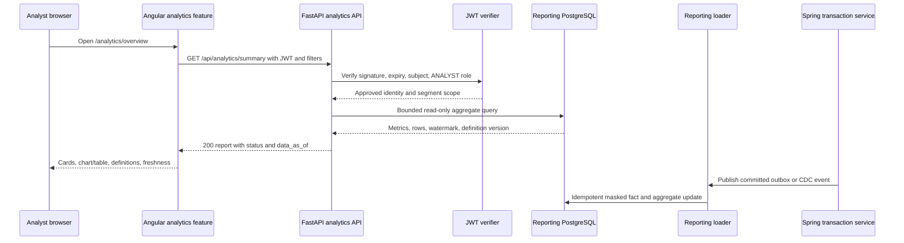

# Analytics Page Implementation Record

**Purpose:** step-by-step implementation record for connecting the Angular analytics workspace to a separate Python FastAPI and SQLAlchemy reporting service.

**Current status:** provisional service, reporting schema, Compose isolation, and Angular workspace shell implemented; authoritative reporting data and metric definitions remain intentionally unavailable.

**Source documents:** `analytics_adsf.md` defines the proposed analytics page behavior. `HailMary.md` defines BR-16 historical analytics isolation and BR-17 useful internal insights. `AnalyticsPage/AnalyticsImplPage.MD` is the companion architecture and API guide.

## 1. Starting point captured

### Verified current behavior

1. Angular already routes analyst users to `/analytics/overview`, `/analytics/trends`, and `/analytics/instruments`.
2. The analyst route policy requires `ANALYST` for those browser paths.
3. Each route currently loads the generic `StaffPageComponent`.
4. Spring currently owns placeholder `GET /api/analytics/summary`, `trends`, `instruments`, and `freshness` routes.
5. Those Spring routes require `ROLE_ANALYST` and return `503 SERVICE_UNAVAILABLE` for every analyst request.
6. The OpenAPI entries describe the same availability boundary and do not define a successful response contract.
7. No Python service, SQLAlchemy model, reporting database, reporting loader, analytics Angular service, or analytics-specific frontend test exists.
8. The notebook is executed exploratory work over generated data. It is not a data source and its numbers are not production evidence.
9. The primary PostgreSQL schema is transactional and lacks durable reporting fill facts, segment history, watermarks, and a reporting outbox.

### Why this baseline matters

The first implementation decision is to preserve the fail-closed behavior until a genuine source and approved definitions exist. Replacing `503` with empty arrays or notebook values would make an unavailable or undefined report look authoritative and would violate the empty, delayed, and unavailable states in `analytics_adsf.md`.

## 2. Target request lifecycle



The dashboard is downstream. It cannot accept an order, change a holding, change cash, or redefine a fill. Current client portfolio and order workflows continue to use Spring-owned endpoints.

## 3. Ordered implementation steps

Each step has a reason, implementation action, and completion evidence. Do not skip the evidence gate before starting the next slice.

### Step 0: Freeze scope and decisions

**Why:** The source documents call the page behavior a proposal and leave metric definitions, segment policy, currency conversion, and freshness thresholds undecided. Code cannot safely guess these values.

**Do:**

- Confirm the first release is read-only.
- Confirm whether the first release uses a real reporting database or an explicitly labelled empty state.
- Approve event dates for submitted, accepted, filled, and booked-fill metrics.
- Approve segment names, entitlements, privacy suppression, timezone, currency policy, and delayed threshold.
- Record decisions with a definition version.

**Evidence:** approved decision record, metric table, API examples, and no unlabelled sample values.

### Step 1: Add the Python service skeleton

**Why:** A separately deployable process is required to make database and query isolation testable.

**Do:** Create `analytics-service/` with a `pyproject.toml`, Dockerfile, FastAPI app entry point, configuration module, SQLAlchemy database module, API module, schemas, repository, service, and tests. Pin compatible versions and use a production ASGI command such as Uvicorn or Gunicorn with Uvicorn workers according to the deployment standard.

**Implementation shape:**

```text
analytics-service/app/main.py              FastAPI app and health routes
analytics-service/app/config.py            environment and policy settings
analytics-service/app/db.py                read-only SQLAlchemy session
analytics-service/app/auth.py              bearer token and role dependency
analytics-service/app/schemas.py           Pydantic contracts
analytics-service/app/api/analytics.py     HTTP route definitions
analytics-service/app/repositories/analytics.py  allowlisted queries
analytics-service/app/services/reporting.py      policy and metadata logic
analytics-service/tests/                   unit, API, and integration tests
```

**Evidence:** the process starts, `/health/live` returns a liveness response, and no endpoint exposes report data yet.

### Step 2: Define reporting schema and migration ownership

**Why:** The current tables cannot prove durable fills, currency-safe aggregation, segment history, or data freshness. A separate schema gives the analytics service an intentional data boundary.

**Do:** Add reporting migrations for instrument and segment dimensions, order-event and fill facts, period aggregates, watermarks, reconciliation runs, and metric definitions. Add unique source-event and fill identifiers. Add correction/reversal columns or a replacement-event model. Do not copy client names, emails, addresses, account data, or raw user records.

**Evidence:** migration creates the reporting database objects, a read-only serving role can select approved views, and the serving role cannot write or alter the schema.

### Step 3: Implement committed source publication

**Why:** BR-16 requires reporting to be downstream of committed business facts. A report loader that reads half-completed transaction state can create numbers that never existed in the legal transaction record.

**Do:** If the current transaction flow has no suitable event stream, add an append-only outbox write in the same transaction as accepted order and booked-fill changes. Include stable event ID, source transaction ID, event type, event time, instrument, quantity, notional/currency, and correction information. Replicate committed events to the reporting loader.

**Do not:** Treat `client_trades.status = EXECUTED` as a booked fill without an approved mapping. Do not allow the analytics API to query the primary transaction database as a shortcut.

**Evidence:** a transaction rollback leaves no report event; a committed event is retried safely; duplicate delivery creates one reporting fact; a correction changes the aggregate exactly once.

### Step 4: Build an idempotent reporting loader

**Why:** Delivery retries and late events are normal. Double-counting one fill would undermine every summary and reconciliation result.

**Do:** Validate event shape, map instruments and segments, mask identities, write facts, refresh period aggregates, update the watermark, and record reconciliation outcomes. Use one transaction per batch or another documented atomic unit. Keep received time separate from business event time.

**Evidence:** replay the same batch twice and obtain the same totals; replay events out of order; verify late-arriving events update the correct period; verify rejected events appear in a quality exception without silently disappearing.

### Step 5: Implement authentication and authorization first

**Why:** A useful report with a weak access boundary is a security regression. The API must be protected before it receives real data.

**Do:** Add a FastAPI dependency that verifies JWT signature, expiry, issuer, audience, and `sub`, then checks `ANALYST` in the verified `roles` claim. Add segment entitlement checks from trusted policy. Use a production issuer/JWKS model when available; use the shared local secret only for the current stub environment.

**Evidence:** tests cover missing token, malformed token, wrong signature, expired token, `CLIENT`, `FINANCE`, and `ANALYST`. Direct HTTP calls reproduce the same `401` or `403` decisions as the browser.

### Step 6: Write the API contract tests before query code

**Why:** The existing OpenAPI analytics entries do not define successful responses. Contract tests prevent the frontend and backend from inventing incompatible shapes independently.

**Do:** Define typed models for common report metadata, summary, trends, instruments, freshness, filters, and errors. Test required dates, date order, timezone, granularity, allowlisted measures, page bounds, and empty result semantics. Include examples with separate quantities and currencies.

**Evidence:** tests fail before route implementation, then pass with the smallest valid response. Every success response includes data freshness metadata and definition version.

### Step 7: Implement repository queries and metric definitions

**Why:** SQL must be bounded and metric semantics must be explicit. The route should coordinate, not contain arbitrary joins.

**Do:** Use SQLAlchemy 2.x expressions against reporting views or aggregate tables. Map every accepted filter and sort key to a known expression. Use `Decimal`, not float, for quantity and notional. Separate order counts, fill counts, executed quantity, and notional by currency. Apply segment suppression before returning rows.

**Evidence:** PostgreSQL integration tests prove distinct-order versus distinct-fill behavior, timezone grouping, currency separation, pagination, corrections, suppression, and no arbitrary-column injection.

### Step 8: Implement freshness and failure semantics

**Why:** `data_as_of` is part of the meaning of every figure. A stale report that looks current is worse than an explicit unavailable state.

**Do:** Read watermark and report data consistently. Return `CURRENT` only within the approved lag threshold. Return `DATA_DELAYED` with the last valid result when possible. Return `PARTIAL` when only specified measures or periods are affected. Return `503` when no valid report can be served. Never fabricate a load timestamp or replace unknown values with zero.

**Evidence:** deterministic tests cover current, delayed, partial, unavailable, and no-activity responses. The response distinguishes `data_as_of` from HTTP generation time.

### Step 9: Add Docker Compose wiring

**Why:** Isolation must exist in the runnable environment, not only in Python imports.

**Do:** Add `analytics-database` and `analytics-api` services, health checks, a separate volume, reporting credentials, and analytics host/container port variables. Give the API only its reporting connection string and JWT verification settings. Add a loader service or documented command separately if ingestion runs in the same repository.

**Evidence:** `docker compose config` resolves without secrets in source; the API starts when the reporting database is healthy; inspecting the API environment shows no transactional DB credentials; the API can read reporting fixtures but cannot write them.

### Step 10: Add the Angular API client

**Why:** The generic staff page deliberately has no data contract. Analytics needs typed filters, typed responses, cancellation, and state-aware rendering.

**Do:** Add `AnalyticsApiService` and typed models. Support a configured analytics API base URL. Build query parameters from URL-backed filter state. Update the trusted-origin logic in `api-url.ts` and `AuthInterceptor` so the JWT goes to the configured analytics origin only. Keep the existing Spring origin behavior unchanged.

**Evidence:** Angular HTTP tests verify exact URLs, query parameters, authorization header behavior, cancellation on session change, and safe behavior for an untrusted origin.

### Step 11: Replace the generic analytics page

**Why:** The current component only displays an unavailable message. It cannot meet BR-17 or the proposed page states.

**Do:** Keep the existing browser routes and analyst guard. Lazy-load an analytics feature component that renders:

- Overview summary cards with unit, period, event date, definition, and currency.
- Date, granularity, market, asset class, instrument, and only approved segment filters.
- Trends chart and exact table toggle.
- Instrument ranking with the selected measure clearly named.
- Freshness/status panel and definitions panel.
- Reset filters and clearly labelled no-activity, delayed, partial, unavailable, and pending-definition states.

Do not add buy, sell, holdings, unrestricted order search, client names, cash adjustment, audit evidence, or access administration to this workspace.

**Evidence:** component tests render each state; the chart does not hide exact values; filters remain visible after no activity or failure; sample mode is visibly labelled; mobile and desktop layouts do not overlap.

### Step 12: Update API documentation and remove ambiguity

**Why:** Two services cannot silently own the same path with different contracts.

**Do:** Update `docs/api.yaml` to describe FastAPI success responses, parameters, `401`, `403`, `422`, `429`, and `503` behavior. During cutover, either route the path only to FastAPI or document a temporary proxy. After frontend cutover and direct API tests pass, remove or deprecate the Spring placeholder mappings and update their tests.

**Evidence:** OpenAPI examples match Pydantic response models; no active frontend code calls the old Spring `staffAvailability()` path; the old 503 test is intentionally replaced by a service ownership test.

### Step 13: Reconcile and prove performance isolation

**Why:** A working chart alone does not demonstrate BR-16.

**Do:** Select a period and compare reporting aggregates with source facts by day, instrument, segment, unit, and currency. Record known lag and corrections. Run bounded but heavy analytics queries while exercising the core order path. Compare the result with the approved latency/error budget.

**Evidence:** a signed or stored reconciliation result, visible `data_as_of`, documented exceptions, query plans, and a concurrent-load report showing no material degradation against the agreed criteria.

### Step 14: Run the full regression gate

**Why:** Authentication, routing, API origin handling, database setup, and existing client workflows are shared surfaces.

**Do:** Run the narrow tests after each slice, then:

```text
cd analytics-service && pytest -q
cd analytics-service && ruff check .
cd frontend && npm test
cd frontend && npm run build
cd backend && mvn -B test
cd testing && mvn -B test
docker compose config
python scripts/smoke-role-workspaces.py
```

Use the local project's exact flags if a command is configured differently. Store the command, result, and date in the implementation log.

## 4. TDD operating procedure

### Red

Write the smallest failing test for one behavior. Start with contract and authorization tests before adding report data. A failing test should identify the request, token claims, filters, expected status, and expected response metadata.

### Green

Implement only enough code to pass that test. Keep route, policy, query, and rendering responsibilities in their intended layers. Do not add an unapproved metric just because it is easy to calculate from an existing column.

### Refactor

After the narrow test passes, remove duplication, move SQL out of routes, tighten types, and preserve the same behavior. Rerun the narrow test after each refactor.

### Regression recovery

When implementation tests or regression tests go in the wrong direction:

1. Stop at the first failure; preserve the output and fixture.
2. Classify it as contract, authorization, data definition, query, UI state, routing, container, or performance.
3. Compare the recent owned diff with the last green state. Do not reset unrelated work.
4. Restore the smallest last-green slice if the new change is the cause.
5. Add a focused regression test before repairing the implementation.
6. If the expected behavior is genuinely changing, update the written contract and definition version before changing the test.
7. Rerun the same narrow test, then adjacent tests, then the complete suite.
8. Record the failure, cause, fix, and validation command below.

Never make a test pass by treating `503`, an empty list, a null metric, or a fabricated timestamp as a successful report unless that is the explicitly tested state.

## 5. Acceptance matrix

| Area | Acceptance check | Result |
|---|---|---|
| Navigation | Analyst reaches all three browser routes; non-analyst is denied | Not run |
| API auth | Missing/invalid token is `401`; valid non-analyst is `403`; analyst can read | Not run |
| Isolation | API has no transaction DB credentials and reads reporting DB only | Not run |
| Definitions | Every displayed metric names unit, event date, period, and definition version | Not run |
| Currency | Notional is separated by currency unless approved conversion exists | Not run |
| Units | Quantities are not summed across unlike instruments or units | Not run |
| Freshness | `data_as_of`, last load, state, timezone, and warnings are visible | Not run |
| Empty state | Valid no-row filter shows no activity, not an error or false zero | Not run |
| Delayed state | Last valid values remain visible and are labelled delayed | Not run |
| Privacy | No names, emails, unrestricted accounts, or individual orders in default responses | Not run |
| Idempotence | Duplicate source delivery does not double count a fill | Not run |
| Reconciliation | Selected period matches source facts with documented lag/exceptions | Not run |
| BR-16 load | Heavy reporting queries do not materially degrade live order processing | Not run |
| Regression | Existing Angular, Spring, database, and role smoke suites pass | Not run |

## 6. Change log

### 2026-10-14 - Documentation baseline

- Read `analytics_adsf.md` and `HailMary.md` in full.
- Refreshed the current `analytics/analytics.ipynb` summary and inspected its executed cells.
- Confirmed the three Angular analytics routes and the `ANALYST` workspace policy.
- Confirmed the four Spring analytics endpoints are authorization-protected `503` placeholders.
- Confirmed OpenAPI has availability-boundary entries and no active success contract.
- Confirmed there is no analytics container, reporting database, FastAPI service, SQLAlchemy model, or analytics-specific Angular service.
- Created this implementation record and the companion root guide.
- No application code, schema, Docker, or endpoint behavior was modified.

### 2026-10-14 - Provisional analytics slice

- Added `analytics-service/` with FastAPI health routes, JWT analyst authorization, typed filter models, and explicit `503` report behavior until a genuine source is connected.
- Added a separate reporting migration with pseudonymous dimensions, source event/fill facts, period aggregates, watermarks, metric definitions, and reconciliation runs.
- Added separate Compose reporting database/API services and environment template values; Docker validation was unavailable because Docker is not installed in the local environment.
- Replaced the three generic Angular staff pages with a URL-backed analytics workspace containing filters, view tabs, freshness metadata, and explicit unavailable/no-value states.
- Removed Spring analytics placeholder ownership and updated its authorization test matrix.
- Updated the OpenAPI analytics paths to describe FastAPI ownership and typed success/error contracts.
- Added `impDocs/Frontend/AnalyticsPage/ImpResult.MD` with the usability assessment and data-connected design direction.
- Focused validation passed: analytics service `5` tests and Angular analytics `2` tests.

## 7. Decision log template

Use this section during implementation so decisions remain traceable:

| Date | Decision or failure | Reason | Evidence or approval | Follow-up |
|---|---|---|---|---|
| 2026-10-14 | Keep analytics fail-closed until a genuine source and definitions exist | Existing Spring boundary and source documents require this | Repository inspection and analytics specification | Implement Step 0 |
