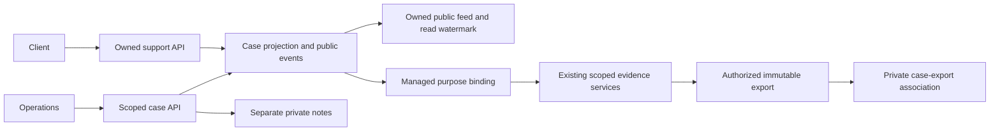
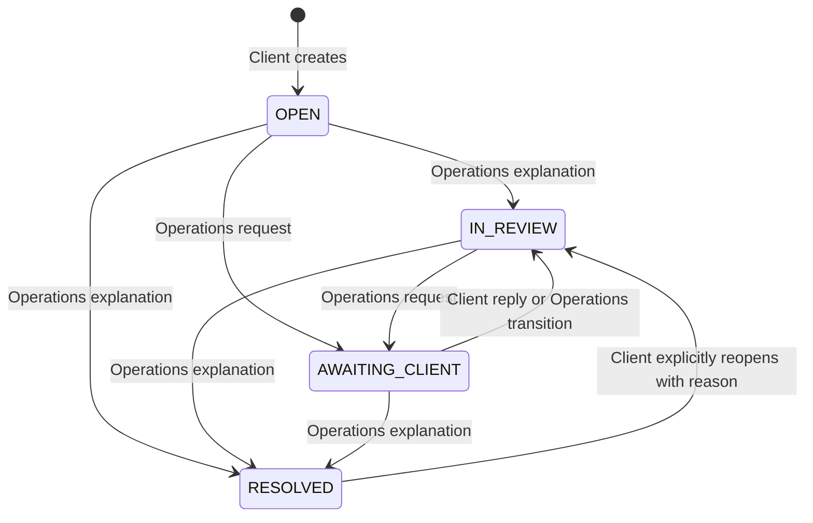
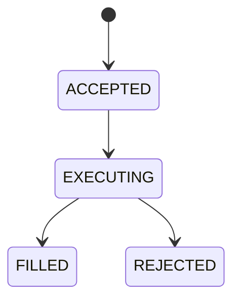

# Managed support integration guide

## Private workflow extension (schema 017)

The existing public conversation and its original-key recovery remain intact. New intake is versioned, bounded to 12000 normalized JSON bytes and accepts only category-allowlisted fields. Client-submitted observation times/reasons are reports, not verified source facts. Legacy submissions without intake remain compatible. Staff see server-authorized actions rather than inferring mutation permission from role.

The private queue supports owner/priority/effective-category filtering inside live CASE_READ scope before count/page. The workbench has an independent version, eligible ownership, next action/due time, checklist revision/history and atomic resolution. Reclassification and client reopen create a fresh checklist revision without copying old completions. Private operations do not change the public projection, time, feed or unread state.

| Category | Evidence and final disposition boundary |
| --- | --- |
| ORDER_QUESTION | Review the owned order under the exact managed case context. Explanation of rejection/recovery requires the retained REJECTED/FILLED result; quotes/internal fills do not establish external settlement. |
| ACCOUNT_REVIEW | Read redacted account/setup/movements with ACCOUNT_DIAGNOSTICS. CLIENT_SETUP_COMPLETED requires actual onboarding and saved-bank prerequisites; do not unlock or repair funds. |
| HISTORICAL_RECORD | Read allowlisted provenance with independent RECONCILIATION_READ. Historical evidence is not current spendable cash. Escalate unresolved provenance rather than rewriting source records. |
| TRADING_AVAILABILITY | Compare reported instrument/side/time with current policy, eligibility and passive provider observations. Quote eligibility may be UNKNOWN; never submit a test trade. POLICY_CHANGE_VERIFIED requires an independently authorized audited policy change. |
| OTHER | Retain bounded clarification/reproduction and reasoned evidence limitations. Duplicate resolution requires an authorized distinct case; specialist resolution needs attributable follow-up or a decided linked review. |

Every category requires a live eligible owner, valid reasoned checklist and category resolution code. Order task references are revalidated at write and resolution. Missing independent evidence permission is unavailable, not permission conferred by assignment. Resolution commits the public event, private snapshot/history, original-key receipt and required audit together; audit failure rolls everything back.

Referrals create independent Compliance `REVIEW-...` records, including account-only investigations. Minimal Operations handoff contains status/reviewer/disposition, information requests and private proposed public reply, never full findings. Mandatory unresolved reviews block resolution. No Compliance action publishes client content or changes trading state.

The default-false `SUPPORT_WORKFLOW_ENABLED` rollout requires schema 017 and least-privilege grants. Local Compose opts in; hardened deployment does not seed fixtures. Read `/api/operations/readiness` for schema/runtime readiness and the explicit unconfigured response target. Existing public-only cases remain compatible while retained intake/private requests prevent flag-off resolution bypass.

Private command metadata persists only actor/resource/action/key. The original body stays in memory; retry/recovery never replaces a key after an unknown result or lookup 404. Changing account/resource/context/session cancels old reads. A private export association is immutable metadata, not download authority; use its role-specific protected export endpoint and live matching purpose, requester, account/order, expiry and digest checks.

Setup uses the complete migration chain through 017 and reapplication of `database/runtime-grants.sql`. The actual-runner compatibility rehearsal is `python3 scripts/test-compliance-migrations.py`; it is separate from browser/production-provider acceptance.

## Purpose and scope

Clients can now open a durable support case against an owned order or an account issue, recover an uncertain submission, find the conversation after signing in again, exchange public messages with permitted Operations staff, and reopen a resolved case. Operations can locate cases within its account grants, keep private investigation notes, and bind an approved investigation purpose to the actual case. Resolving a case changes support state only.

Owned trading receipts, keyed order recovery, reservations, internal booking, scoped Operations evidence, reconciliation reads and controlled exports already existed. This integration connects those capabilities; it does not replace their financial or authorization rules. The business requirements baseline supplies BR-02/03, BR-05–11 and BR-13–15 context. Managed support itself is an explicitly requested enhancement, not a claim that the baseline requires a full helpdesk.

| Area | Before | Delivered behavior |
| --- | --- | --- |
| Support entry | External process and typed reference | Owned account/order case with generated reference and committed receipt |
| Follow-through | No persisted case conversation | Public history, separate staff notes, explicit lifecycle and replay receipts |
| Investigation purpose | External reference metadata | Explicit EXTERNAL or verified MANAGED reference, with independent live grants |
| Client explanation | Basic receipt and first 100 events | Allowlisted retained quotes/checks and event paging |
| Update health | Bounded order polling with silent failures | Visible failures, last successful check, exhaustion and resume |
| Case updates | No support inbox | Public activity and durable recipient read watermark |
| Controls/help | Coarse availability and disconnected support wording | Side-aware instrument guidance and account-level support links |



## Setup and prerequisites

Use Java 21, PostgreSQL 15 and Node 22, or the repository's Docker-based commands. Start with the existing root setup documentation and credential guidance in the Client and Operations implementation directories; do not copy passwords into tickets or logs. Normal Compose startup, the explicit HTTP provider fixture and hardened deployment are different environments. Fixture prices establish repeatable behavior, not live-provider correctness.

Run the complete disposable regression harness:

```sh
bash scripts/test-role-workspaces.sh
```

For process/recovery exercises, package the current backend first:

```sh
mvn -B -f backend/pom.xml -DskipTests package
python3 scripts/test-client-compose.py
python3 scripts/test-hardened-config.py
python3 scripts/test-client-recovery.py
python3 scripts/test-operations-demo.py
```

These verification scripts create isolated resources. Inspect their prerequisites and available ports before running them. Do not substitute a retained database into their test variables. For an explicitly disposable browser environment, `scripts/start-client-review.sh --http-fixture` uses the HTTP fixture; use a distinct `REVIEW_PREFIX`. Its default configuration does not provision case grants. Operations testing requires the approved purpose configuration and explicit fixture-only account grants described below.

Apply the ordered `database/migrate.sh` chain through `017_compliance_referrals.sql` before enabling the extension. Fresh installations use `database/fresh/001_schema.sql` and `002_reference.sql`. Reapply `database/runtime-grants.sql` with the intended restricted runtime identity. The Operations readiness response includes `supportSchemaReady` and private schema/runtime readiness; evidence protection also checks immutable support tables. A privileged schema owner is not a substitute for runtime-grant verification.

Relevant non-secret configuration names include `OPERATIONS_ACCESS_ENABLED`, `OPERATIONS_ALLOWED_PURPOSES`, `OPERATIONS_POLICY_VERSION`, `OPERATIONS_CONTEXT_SECONDS`, `OPERATIONS_EXPORT_SECONDS`, `TRADING_ADMISSION_ENABLED`, `TRADING_WORKER_ENABLED`, `TRADING_LOCAL_DEMO_SETUP`, `DB_URL`, `DB_USERNAME`, `CORS_ALLOWED_ORIGINS`, and provider connection/timeout settings. See `application.yml` and the Operations runbook for authoritative defaults. Credentials and encryption/signing keys remain secret configuration.

Existing grants are not widened by migration. Approved provisioning must explicitly grant `CASE_READ` and, for writes, `CASE_UPDATE` for the appropriate account and validity interval. Existing evidence and export permissions remain independently necessary. Standard local Compose explicitly provisions CASE_READ and CASE_UPDATE for both seeded local client accounts; hardened deployments retain approved provisioning. No grant-management UI or administrator bypass is added.

## Client walkthrough

1. Sign in as the owning Client. Open **Orders**, select a receipt, then **Ask about this order**. The form carries the order ID and fetches the owned receipt again; query-string descriptions are not evidence.
2. Choose a category, enter a subject of 5–120 characters and a plain-text description of 10–4000 characters. Do not include passwords, tokens, full bank details or identity documents. The warning reduces accidental disclosure; it cannot guarantee that free text is harmless.
3. Submit once. A confirmed response displays the generated `CASE-…` reference and a **View case** link. Submission means the case is retained; it does not promise an operator is actively reviewing it.
4. If the outcome is unconfirmed, use recovery or retry with the same request key. A 404 lookup means no committed receipt was found at that moment. It is not permission to replace the key. After reload, the browser retains the opaque key, not the description; if no commit exists, re-enter the original content and retry.
5. Open **Support**, search by reference or subject, filter by public status, and page through owned results. Select the reference to read public history. Use **Refresh conversation** to fetch current authoritative state before responding; the detail page is not a live chat.
6. Add a public reply. When Operations requested information, the reply returns the case to **In review**. A resolved case instead offers explicit reopening with a reason. A conflict means another public action won first: refresh and review it before sending again.
7. In **Case updates**, review durable public activity and explicitly choose **Mark displayed updates read**. Merely loading activity does not mark it read.

For an account-only issue, use the support link beside account-review, historical-record or trading-availability guidance, or create a case from Support without an order. Categories are `ORDER_QUESTION`, `ACCOUNT_REVIEW`, `HISTORICAL_RECORD`, `TRADING_AVAILABILITY`, and `OTHER`. An account case does not fabricate an order or attach banking/profile data.

## Operations walkthrough

1. Sign in with an enabled Operations identity that has `TRADING_OPS` and does not also contain `CLIENT`. Open **Support cases**. The queue includes all cases within current `CASE_READ` account grants, including cases nobody has claimed. Assignment is not implemented.
2. Search/filter and open a case. The public conversation is the same retained history seen by its owning client. Separate **Internal notes** are visible only through the staff endpoint.
3. For an investigation, use the case's managed-reference context form. Choose an approved purpose and **MANAGED** reference type. The server resolves the case and retains its identity. An order-linked case confines evidence to that order; an account-only case confines evidence to the account. A context still requires live case and evidence authority on each protected request.
4. Follow the linked order to existing Operations evidence. Review captured admission/execution facts, reservations, fills and permitted reconciliation findings. Current quotes do not replace historical execution evidence.
5. Use **Send public reply** for a client-visible explanation. Use the separate **Internal note** action for investigation notes. Private notes do not alter public version, ordering, timestamps, unread counts or notification activity.
6. Publish **Awaiting client** with the information request, or **Resolved** with a public explanation. Escalation to Finance is explanatory text describing the existing operating process; it does not run reconciliation or repair money.
7. Generate an export using the existing authorized evidence flow. With the matching managed context, associate that export with the case. Association requires live case write/read authority plus the original export requester's context, evidence/export permissions, unexpired metadata and matching digest. It neither publishes ZIP bytes to the client nor extends expiry.

External investigations remain valid: choose **EXTERNAL** and use an approved operational reference. A UUID-shaped managed reference cannot be relabelled external to evade case binding. Old immutable contexts remain external; migration invents no historical cases.

## Identifiers and lifetimes

| Identifier | Meaning and lifetime |
| --- | --- |
| Case reference | Non-PII `CASE-` plus random UUID; durable public locator, never an entitlement |
| Case ID | Internal UUID and foreign-key identity; not a browser-selected owner |
| Order ID | Retained owned trading receipt; case association does not change it |
| Request key | 16–128 letters/digits/underscore/hyphen; identifies one normalized write and its replay receipt |
| Correlation ID | Request diagnostics; not a case, receipt or authorization token |
| Purpose context ID | Immutable expiring approved-purpose record; managed contexts retain the case binding |
| Execution reference | Internal booking identity; does not prove exchange execution or external settlement |
| Export ID | Immutable artifact identity with requester, context, expiry and digest checks |

The browser persists only owner-scoped creation keys and action metadata (key, action, expected version, proposed status) in session storage. Prose stays in memory and clears on identity change or authorization denial. Session storage must be available before writes start. Same-account reauthentication in that tab can recover retained keys. Clearing browser storage loses local recovery convenience, not committed server history; find the case in the owned list. There is no private-draft persistence or cross-device draft synchronization.

## State and visibility rules

Case lifecycle:



Order lifecycle is separate:



Retained legacy orders may have historical states and incomplete evidence. Support does not rewrite those states. The diagram describes current accepted execution, not admission rejection before acceptance.

| Action | Required actor/authority | Public effect |
| --- | --- | --- |
| Create | Current Client session; linked order owned | OPEN, version 1, first public event |
| Read/list | Owner; or Operations with live CASE_READ | Public summary/history only |
| Client reply | Owner, expected version, unresolved case | Public event; AWAITING_CLIENT becomes IN_REVIEW |
| Reopen | Owner, expected version, RESOLVED, reason | Public event and IN_REVIEW |
| Staff reply | CASE_READ and CASE_UPDATE, unresolved case | Public event; status unchanged |
| Staff transition | CASE_READ and CASE_UPDATE, allowed transition, explanation | Public event, new status/version/time |
| Internal note | CASE_READ and CASE_UPDATE | None; separate append-only staff record |
| Mark read | Owning recipient and owned cursor | Recipient watermark only |
| Export association | Case write/read plus existing export authority | None; private evidence association |

Every public message/transition requires 10–4000 characters. Public actions use expected versions and atomic replay receipts; replay precedes version comparison. A conflicting key payload returns 409. An invalid transition cannot silently overwrite a concurrent action. Original messages cannot be edited/deleted; corrections are new attributable entries.

## Reading receipts and evidence

Indicative charts/preview quotes are estimates. The receipt's retained quote projection identifies admission or execution stage, applicable ASK for buys/BID for sells, exact decimal price, source/provider and retained time/freshness facts. `usedForFill` distinguishes an observation linked to booking. Missing observations are not reconstructed from the current provider.

Submission time precedes acceptance. An accepted or executing order can hold a reservation while final execution is pending; a reservation is not a posted fill. Filled orders retain internal booking evidence. Rejected outcomes require the appropriate release, and admission rejection need not have a reservation at all. Neither a fill nor an execution reference certifies an external settlement.

The client receives an allowlist, never raw staff decision contexts. Checks describe retained admission, timeline continuity, notification facts, decision/quote links, reservation state and fill/quote/event/owned posting relationships. Completeness is `PENDING`, `INTEGRITY_FINDING`, `PARTIAL` when the bounded quote/decision projection exceeds 200 rows, or `RETAINED_INTERNAL_EVIDENCE`. These bounded relationship checks are not a global reconciliation certificate. Historical/unavailable facts remain labelled rather than fabricated. A retained notification fact is not proof of external delivery.

Order detail initially shows 100 events. Paging retrieves further owned events through `/api/orders/{id}/events`. Each page rechecks ownership. Case conversations use 20 rows in the UI, with server page sizes bounded to 100. Public and private histories have separate paging.

Instrument pages refresh availability through existing catalog refresh conventions. Buy-only, sell-only and full halt states constrain the ticket's permitted side. Server preview/admission revalidate current policy. A halt does not discard an uncertain existing order's key or receipt recovery path, holdings, history or support entry.

## Updates, failure and recovery

Order updates poll every three seconds for up to 200 ticks (about ten minutes). Health displays connection state, stale/error state, last successful check and exhaustion. **Resume** reconnects using retained cursor/version state and fetches authoritative resources. Temporary transport failure may leave authorized data visibly stale; identity change and authorization loss clear protected content.

Case updates use a separate public-only ordered feed, 100 records per batch, and a persisted per-recipient read watermark. Polling checks every 15 seconds for up to 200 ticks (about 50 minutes). Page through pending batches, then resume checks. Replayed pages are deduplicated by event ID; a server reset clears the local page. New activity refreshes the case list. Detail history uses the explicit conversation refresh control. Unread state survives reload/server restart and is acknowledged only by the explicit read action. Notes never enter this feed.

Only authenticated in-app support updates are implemented. Email, SMS and push are unavailable. Trading outbox delivery remains separately configured and is not a support delivery guarantee.

| Component/message | Meaning | Recovery |
| --- | --- | --- |
| No matching cases | Successful scoped search with no rows | Change filter/reference; do not infer service failure |
| Case not found / 404 | Missing or inaccessible object; intentionally non-disclosing | Verify reference and identity; staff verify approved account scope |
| Case access unavailable / 401 or 403 | Session or authority no longer valid | Reauthenticate or use approved access process; cached prose clears |
| Outcome unconfirmed | Response did not establish commit | Recover/replay original key and original normalized request |
| No committed case/activity found yet | Lookup has no receipt currently | Retain key; re-enter original text if needed; retry same action |
| Case changed / 409 | Another public action advanced version | Refresh, read new activity, then submit a deliberate new action |
| Same-key conflicting content / 409 | Key already belongs to a different command | Recover original receipt; never mutate/reassign its key |
| Invalid transition | Requested state is not allowed from current state | Refresh and select a valid action with explanation |
| Enable session storage | Browser cannot retain recovery metadata | Enable storage before sending; no prose is stored |
| Updates stale or automatic checks paused | Transport failure or bounded timer completed | Refresh and resume; inspect last successful check |
| Purpose expired/policy changed | Existing context no longer authorizes access | Create a current approved context; grants still required |
| Missing retained evidence | Relationship absent, partial or historical | Open case/investigate authorized facts; do not reconstruct evidence |
| Provider trouble/trading unavailable | Current quote/control prerequisite failed | Keep receipt recovery; retry when appropriate or open account case |
| Account requires review | Account trading eligibility withheld | Account-review case; no balance repair through support |
| Reconciliation unavailable | Required scope/readiness or retained run absent | Verify Operations read permission; Finance retains run authority |

## API and implementation reference

`docs/api.yaml` is the contract. All support responses are private/no-store. Session-derived identity is checked in services as well as controllers. Foreign and missing objects use non-disclosing behavior. Clients cannot supply owner, author, visibility, assignment or privileged transition fields; unknown fields are rejected.

| Route | Operation |
| --- | --- |
| `/api/support/cases` | GET owned list; POST creation with Idempotency-Key |
| `/api/support/cases/by-request/{key}` | GET owned creation receipt |
| `/api/support/cases/{reference}` | GET owned public detail/history |
| `/api/support/cases/{reference}/replies` | POST public client reply |
| `/api/support/cases/{reference}/reopen` | POST explicit reopening |
| `/api/support/cases/{reference}/requests/{key}` | GET actor-scoped action receipt |
| `/api/support/updates` | GET public activity after cursor |
| `/api/support/updates/read` | POST owned cursor acknowledgement |
| `/api/operations/cases` | GET scoped actionable queue; explicit All/Unassigned/My/Awaiting client/Awaiting internal review/Resolved views |
| `/api/operations/cases/{reference}` | GET scoped public detail |
| `/api/operations/cases/{reference}/replies` | POST client-visible staff reply |
| `/api/operations/cases/{reference}/notes` | GET private notes; POST private note |
| `/api/operations/cases/{reference}/transitions` | POST public status/explanation |
| `/api/operations/cases/{reference}/requests/{key}` | GET staff actor's action receipt |
| `/api/operations/cases/{reference}/exports` | POST authorized immutable export association |
| `/api/operations/access-contexts` | POST explicit EXTERNAL/MANAGED purpose binding |

Creation fields are `category`, `subject`, `description`, optional integral `orderId`. Actions use `expectedVersion`, `body` and, only for transitions, `status`; writes use `Idempotency-Key`. Subject/prose are trimmed, bounded and checked for prohibited controls (newline/tab permitted in prose). Lists use `status`, `search`, zero-based `page`, `pageSize` (1–100, default 20); offset is bounded to 100000. Ordering has a stable ID tie-breaker and scope is applied before counts/paging. Updates use nonnegative numeric cursors belonging to the owning stream; future cursors request a reset, foreign cursor IDs are rejected. Read acknowledgement takes `{ "cursor": eventId }` and is monotonic/idempotent.

With the workflow enabled, the staff queue additionally accepts `view`, `assignee`, `priority`, effective `category` and `overdueOnly`. The default view is ACTIONABLE (unresolved); ALL includes resolved cases, MINE uses the authenticated actor, and AWAITING_REVIEW selects unresolved cases with a linked undecided Compliance investigation. Explicit status without a view retains its status-specific behavior. These selectors never affect client lists and are unavailable during disabled rollout.

ACCOUNT task evidence can use the current authorized CASE reference; independent ACCOUNT_DIAGNOSTICS remains required and no internal client ID is exposed. An omitted diagnostic source uses immutable verified intake/order references where retained. Account-wide availability can omit an instrument: policy is explicitly NOT_APPLICABLE and quote eligibility UNKNOWN, rather than inventing policy or probing a provider. Invalid/foreign sources fail closed; a missing order/historical source requires clarification.

Success uses 200 for support writes/reads. Invalid fields, keys, pages and cursors return 400; authentication/role failures use 401/403; missing/inaccessible objects use 404; conflicting replay/version/lifecycle uses 409. Temporary service errors leave write outcome uncertain until recovery proves it. Do not generalize these support statuses to trading admission, which retains its existing 202 contract.

Angular `SupportApiService`, `SupportPageComponent` and `SupportUpdatesComponent` implement the shared client/staff journey; routes and shell policy enforce workspace boundaries. `OrderStatusService`, `OrderUpdateHealthComponent` and `PageResource` manage update/caching behavior. Client order detail and ticket components consume safe evidence and side controls.

Spring support controllers delegate to `SupportCaseService`/`SupportExportService`; `SupportCaseMapper` owns bounded scoped SQL. Existing Operations access/order/reconciliation/export services enforce purpose and evidence authority. `TradingServiceImpl` projects client-safe evidence through `TradingMapper`.

| Table | Responsibility |
| --- | --- |
| `support_cases` | Immutable identity/owner/order plus public status/version/time projection |
| `support_case_events` | Append-only public messages/transitions with per-case unique version |
| `support_case_notes` | Separate append-only private staff prose |
| `support_case_requests` | Actor/case/key hash and durable action receipt |
| `support_read_state` | Owned recipient's monotonic public-event watermark |
| `support_case_exports` | Immutable case/export/digest/actor association |

Composite foreign keys bind cases to owned orders and events to their case owner. Deferred constraint triggers require the mutable public projection to match retained event count/latest state/time. Read-state constraints enforce recipient/event ownership and monotonicity. Restricted grants permit only the required projection/read-state columns to update; events, notes, requests and links cannot be updated, deleted or truncated by runtime.

Creation and public updates acquire the client lock before the case lock, serializing event allocation/commit within an owner's stream. Private notes do not advance that stream. Required successful audits commit with writes and before protected reads are released; denial audits use the existing independent transaction. No support transaction writes financial tables.

## Verification, upgrades and rollback

Final verification passed 400 backend tests, 19 database tests and 170 frontend tests, plus style/build, isolated Compose fresh/upgrade, hardened configuration, restart/restore/export checks and the browser case lifecycle. See `OperationsRefactorCommentary.MD` for observed runs, failures, evidence locations and verification limits. Do not infer that a command shown above has passed merely because it is documented. PostgreSQL tests exercise durable ownership, scoped access, replay/concurrency, private/public isolation, lifecycle, managed contexts, updates, export links, audit failure and schema guards. Angular tests cover routing, recovery, inert rendering, session clearing, explicit read acknowledgement, update health, account links, evidence rendering and halted-side controls.

The recovery harness captures cases/public and private history, action receipts, read watermarks and export associations in the same dump as existing financial evidence. Restore checks original-key recovery, unread state, external contexts, identical ZIP bytes and restricted-runtime writes/immutable protections. It does not promise zero loss beyond its captured snapshot or production recovery timing.

For retained upgrades: back up through the established process; inspect pending older migrations and their drain requirements; run the ordered chain; verify version 12 and new objects; reapply runtime grants; check readiness and scoped reads before opening traffic. Existing external contexts, grants, exports and trading evidence remain unchanged. Repeating the runner should skip applied versions. Never manually mark a failed migration complete.

Rollback means redeploying compatible application code while preserving schema and retained rows. Do not drop support history or reverse financial evidence. An older application may lack the new case routes and explicit context request field, so validate its compatibility in an isolated restored copy before redeployment. Database restoration is a coordinated recovery decision with snapshot loss implications, not a routine schema downgrade.

## Boundaries and extension points

There are no attachments, email/SMS/push, external ticket sync, assignment, staffing guarantees, SLA scheduler, self-service grants, refunds, forced fills, financial repairs, cancellation/amendment, new currencies/markets or broad banking evidence access. Account-level cases can explain existing cash-movement receipts without generalizing order APIs into banking access. No production retention policy is asserted.

Future extensions must preserve separate public/private projections, live case/evidence permissions, atomic replay/audit, owned update ordering and financial noninterference. Resolving support cannot change an order, certify reconciliation or external settlement, extend an export's expiry, or grant access.


## Follow-up: default startup, queue visibility and spacing — 21 October 2026

**Issue: support did not work for Operations after ordinary local startup.** Compose enabled the workspace and ran migrations, but its fixture seed created only four evidence permissions. The case endpoints required separate CASE_READ/CASE_UPDATE grants, so no cases could be opened or answered without a manual database step.

**Fix:** the existing local seed now provisions eight explicit account permissions: the four existing evidence permissions for the primary local client, plus case read/update for both seeded local client accounts. With the existing local `.env` setup and provider configuration, run:

```sh
docker compose build
docker compose up -d
```

The normal dependency chain applies migrations and runs the repeatable local seed before starting the backend. No extra overlay, case-reference fabrication or manual case grant is required for those local accounts. Existing volumes receive missing local case grants through the same startup seed; repeat startup does not duplicate active grants or reinstate revoked ones. The hardened overlay excludes demo seeding and still requires approved, explicit account scopes. Accounts created outside the local fixtures need approved scopes; case access does not create evidence/export authority for them.

**Issue: the Operations queue required too much manual checking and obscured report types.** Its API already returned every category without a category search, but missing local permissions hid reports, the table omitted the category, and newly submitted reports were not automatically refreshed in the staff queue.

**Fix:** the queue initially loads all statuses/categories within current account scope. Search/status filters are optional. A Category column identifies each report, and the existing catalog refresh convention updates a visible queue every 15 seconds and on focus/visibility changes. A Refresh cases action is also available. Pagination remains bounded; larger queues span pages rather than being silently truncated or loaded without limit. The queue covers order questions, account review, historical records, trading availability and other reports together. Identity changes cancel refresh subscriptions and protected requests.

**Issue: Back to cases and Refresh conversation touched in the conversation header.** They were adjacent inline elements outside the shared action layout.

**Fix:** both now sit in an accessible Case navigation group using the shared `actions` layout: 16-pixel gap, wrapping on narrow screens and a consistent button-style back link. Refresh is disabled during the current detail load. The shared layout applies to both Client and Operations case details.

**TDD evidence:** two new Angular behaviors failed before the UI fix (missing spaced navigation group and missing report-category display); the focused suite then passed all eight support tests. A new disposable Compose assertion failed because startup retained four grants where eight scoped permissions were needed. The expanded startup test creates all five categories for both local clients and requests the Operations queue without search or category parameters; it also exercises a public reply, repeatable seeds and retained revocation. Follow-up logs are in `backend/target/operator-followup/`. Final observed regression results are recorded in the adjacent engineering commentary.

Observed follow-up results: **172 frontend tests passed in 28 files**, style/build passed, the expanded standard Compose startup/case/reply/revocation test passed, and hardened configuration passed. No backend Java or database schema change was needed. Run the build/up commands above to apply the updated frontend and local fixture seed to your running environment.
