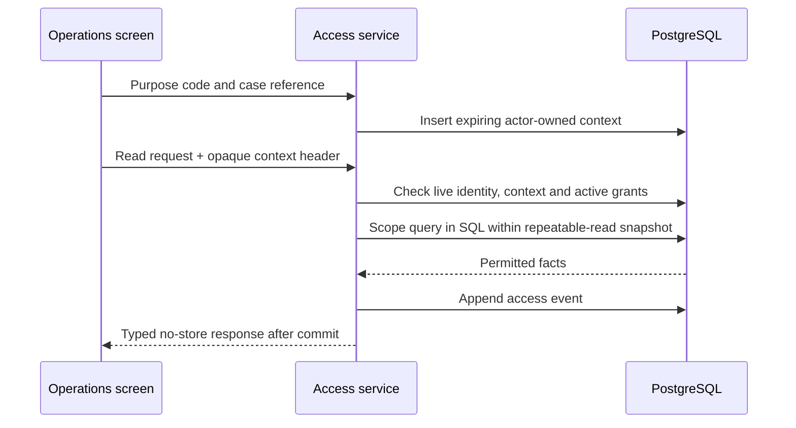

# Operations workspace crash course

## What this workspace does

Operations can investigate permitted orders using retained evidence, inspect processing problems, read stored reconciliation findings, inspect instrument changes, and download a controlled case package. It cannot place an order for a client, change cash or holdings, manufacture a fill, cancel or retry an order, rewrite history, or grant itself access.

The current trading model uses USD and internal booking. A reference beginning with `INT-` identifies an internal execution. It does not confirm execution at an external exchange or settlement at a bank or custodian. Quotes retained with an order are historical observations; investigation never substitutes today's quote for an earlier one.

The workspace follows the existing sidebar, panels, square controls, tables, and responsive layout. Data requests and authorization live in API/services; components display the results. Decimal quantities and amounts remain strings so browser arithmetic cannot silently round evidence.

## Start with the normal Docker Compose commands

With a configured `.env` in the repository root, the normal local startup is:

```sh
docker compose build
docker compose up
```

Use `docker compose up -d` if you prefer it in the background. No Operations overlay, manual grant SQL, or separate seed command is required. Compose applies migrations, creates the existing demo identities, creates scoped Operations demo grants, and starts the backend in dependency order. Running these commands again preserves orders, policies, account balances and grant revocations. Do not delete the database volume to fix configuration.

The local defaults enable purpose `ORDER_REVIEW`, policy version `local-demo-v1`, and one-hour investigation contexts and exports. Startup gives `demo.operations` four permissions for **only `demo.client`**, with account reference `DEMO-CLIENT`, when `TRADING_LOCAL_DEMO_SETUP=true` and `OPERATIONS_ACCESS_ENABLED=true`. Other accounts remain outside its scope. The grants last seven days; normal startup may replace expired fixture grants but respects revoked ones. The recorded test approver is part of this local fixture, not a production approval process. Hardened deployments exclude demo seeding and require their own explicit access configuration.

Open `http://localhost:8086/login` after startup:

1. Sign in as `demo.operations`, password `RoleDemo2026!`. Open **Overview** and **Instruments**.
2. The fourteen startup symbols are AAPL, MSFT, AMZN, GOOGL, TSLA, VOO, AGG, JNJ, PG, NVDA, JPM, UNH, XOM and BRK.B. They are added only after successful provider identity checks. If the provider fails, an empty catalog is explained in the screen; rebuilding alone cannot make an unavailable external API return valid data. SPY is not in this startup list: test and save it through **Add instrument**.
3. Sign in as `demo.client` with the same password and submit a one-share AAPL buy through the existing client order screen. The one-time local USD 10,000 opening is not replenished after spending. Record the order reference.
4. Return as `demo.operations`. In **Orders & monitoring**, select `ORDER_REVIEW`, enter case reference `DEMO-CASE-001`, and start the context. Search for the order or account reference `DEMO-CLIENT`, then select **Investigate**.
5. Review its evidence and prepare/download the ZIP. The monitor is initially empty if this client has no current orders; an empty list does not mean startup failed.
6. To inspect a reconciliation run, sign in as `demo.finance`, run the existing Finance reconciliation action, then return to Operations and start a fresh context. Operations reads the stored result; it does not run the check itself.

Changes to `.env` take effect when Compose recreates the backend during `up`; `build` creates images and `up` creates/starts their containers. `docker compose restart` alone keeps the old environment. Sign out and back in, or reload the page, after changing access configuration. Existing browser contexts do not survive a reload.

### Real provider versus an optional offline test

Standard Compose uses the real provider configured by `FAUX_SERVER_URL` and `FAUX_API_KEY`. It never silently substitutes synthetic prices when that provider fails. The URL must be the provider's base URL, ending at the API version rather than a particular symbol's `/quotes/...` route. The key must be the valid key issued for that service, not the `redacted` placeholder in `.env.template`. Do not paste the key into the UI, case reference or bug report.

A working external provider is required for startup ticker validation, symbol testing and executable orders. Access-policy configuration is independent: fixing the five Operations settings will not fix an upstream quote failure, and a provider failure does not prevent an authorized investigation of evidence already retained in the database.

For a deliberately selected offline test only, the optional fixture supplies labelled synthetic quotes and daily charts:

```sh
docker compose -f docker-compose.yml -f docker-compose.market-fixture.yml build
docker compose -f docker-compose.yml -f docker-compose.market-fixture.yml up
```

This is optional and not required for the standard startup above. Fixture data identifies itself as test data and supports the fourteen startup symbols plus SPY. The existing `docker-compose.operations-demo.yml` is a compatibility convenience; it is no longer required to activate local Operations features. Use the same selected Compose files consistently for subsequent commands. `python3 scripts/test-operations-demo.py` verifies startup in a separate disposable project with an explicit fixture; it never resets the retained application database.

## Sign in and start an investigation

1. Sign in with an enabled staff identity assigned `TRADING_OPS`. An identity also assigned `CLIENT` cannot enter Operations. The historical `OPERATIONS` role is not an alias, and an administrator role is not a bypass.
2. The Operations home is **Overview**. Instrument controls remain available through **Instruments** and **Add instrument**.
3. Open **Orders & monitoring**, **Exception queue**, or **Reconciliation**.
4. In **Access purpose**, choose a configured purpose and enter an 8–200 character case reference. Use a reference meaningful to your investigation process; omit credentials, bank details and unnecessary personal information.
5. Select **Start context**. The expiry time appears in UTC. The server records the context against your authenticated identity.
6. When finished, select **End context and clear evidence**, or sign out.

A purpose context explains *why* you are looking; it never expands *what* you may see. Each account requires an active, explicitly approved permission. Contexts exist only in browser memory, so reloading the application requires a new context. Context expiry, session changes, and denied access clear displayed sensitive data and cancel pending reads. All sensitive HTTP responses prohibit caching.

If the purpose panel says access is unconfigured, the deployment has not enabled the policy. If a request is denied, the context may have expired or the required account grant may be absent, expired, or revoked. Knowing an order reference does not confer access.

## Find an order

Use **Orders & monitoring**:

| Filter | Meaning |
| --- | --- |
| Exact order reference | Positive internal order ID. Useful for a dispute or support case. |
| Approved account reference | Exact reference assigned with your account grant. This is not a client name/email search. |
| Instrument ID | Positive instrument identifier from the catalog. |
| Record kind | `SELF_DIRECTED` for the current engine; `LEGACY` requires an exact order ID. |
| Status | Current engine: `ACCEPTED`, `EXECUTING`, `FILLED`, `REJECTED`. Legacy records have a separate state model. |
| Side | Buy, sell, or both. |
| Rejection stage | Admission or execution. |
| Submitted from / before | UTC start-inclusive, end-exclusive range, at most 31 days. This filters submission, not acceptance. |
| Queue preset | Rejected, past persisted execution deadline, or retrying/expired lease. |

Select **Search** after changing filters. With no time filter or exact reference, search covers the previous seven UTC days plus today. An exact reference can retrieve an older order without broadening a historical scan. Legacy dates are not presented as precise UTC submission timestamps.

The list shows exact quantity, side, currency, record kind, current state, submission/acceptance times and queue category. **Next page** uses a signed cursor tied to the current user, context, filters and active grants. **First page** restarts the search. Changed grants invalidate old cursors; start again if the server asks you to do so. Counts and cursors never use an unrestricted account result set. Overlapping grants do not duplicate rows.

Nonsensitive status/time filters are preserved in the URL. Case explanations and approved account references are not put in URL state. The list refreshes while visible, without overlapping requests. A failed transport refresh may retain explicitly marked stale results; access denial clears them. Paging is a live view and can reflect concurrent state changes. Use an export for a fixed, reproducible snapshot.

## Explain an order

Select **Investigate**. The summary includes the immutable instruction, submitting actor reference, acceptance time, current version, snapshot time, reason and completeness findings.

- **Admission rejection:** no recorded acceptance. It was never accepted into processing.
- **Execution rejection:** the instruction was accepted, but a later check prevented filling; examine the released reservation and terminal decision.
- **Accepted/executing:** still pending. A retry does not create another client instruction or imply a fill.
- **Filled:** internally booked. Inspect the linked fill and signed cash/position deltas.

The investigation separates these sections:

| Section | What to inspect |
| --- | --- |
| Events | Recorded per-order sequence, previous/new state, actor, quote/fill links and occurrence time. |
| Decisions | Admission/execution outcome, rule/policy version, explanation and linked quote. New decisions include captured checks and account resource inputs. |
| Quotes | Retained stage and observation envelope, bid/ask, source, symbols/units, provider/receipt/metadata times, freshness and market state. IDs are internal observation IDs. |
| Attempts | Lease claims, retries and terminal outcomes. Raw claim tokens are suppressed. |
| Reservations | Exact cash/unit amount, active/consumed/released state and start/end times. |
| Fills | Internal reference, quantity, price, gross, fee, currency, quote and posting group. |
| Postings | Exact signed cash and position changes linked to the fill. These are not reconstructed historical balances. |
| Notifications | Facts committed alongside lifecycle changes. Delivery is `NOT_CONFIGURED`; retained facts do not prove external delivery. |

Use **Show captured values** to expand structured facts. Every section has its own paging controls and rechecks authorization. The summary and first sections come from one repeatable-read transaction; later pages are fresh reads. Events use their recorded sequence. Equal timestamps across separate evidence types do not prove causation.

**Policy at acceptance and current controls** separates retained limits from today's halt/side controls. Current policy edits do not rewrite the original policy. New execution decision contexts retain both policy sources, the observed resource values and the final outcome. The rule list reports `PASS`, `FAIL`, and `NOT_EVALUATED`; short-circuited checks are not reported as successful. Account, banking-presence, available-resource, current-halt, direction and deadline checks also retain individual outcomes. A side-specific check that does not apply is `NOT_EVALUATED`. The final decision preserves the engine’s existing override precedence; an earlier pricing failure can be superseded by a current execution control. Context-level stage, policy snapshots, observation time and resource inputs apply to the recorded check list.

Historical missing fields remain `NOT_RECORDED`. No backfill reruns today's rules against today's balances. Prospective decision correlation identifies the retained decision context; it is not a claim that historical transactions had an end-to-end distributed trace. Malformed requests and provider failures before a durable order exists are not covered by an order investigation.

Completeness states:

- `PENDING`: nonterminal order with the required current processing relationships.
- `COMPLETE_FOR_INTERNAL_BOOKING`: the implemented relationship checks found required terminal evidence; this does not certify external execution, historical resource coverage, retention compliance, or independently anchored integrity.
- `INCOMPLETE`: missing/inconsistent state event, quote link, fill, posting, reservation, notification, sequence, or an evidence snapshot over its bounded limit. Inspect the machine-readable findings.
- `INCOMPLETE_LEGACY`: historical record lacks the current engine's evidence model.

## Triage an exception

Open **Exception queue** and choose a preset:

1. **Rejected** includes admission and execution rejections. Read the code and stage before treating it as an incident. Insufficient cash or a closed market can be expected business outcomes.
2. **Past persisted deadline** finds noncompleted jobs whose execution deadline has passed.
3. **Retrying / expired lease** finds active jobs with more than one attempt or an expired lease. Open the attempts section to distinguish retry from recovery.
4. Open the order and examine the retained cause and current job deadline/next attempt.
5. Escalate through the approved operating process if evidence is inconsistent or processing remains stopped.

Refreshing never requeues, books, cancels, releases, or edits an order. There is no invented `FAILED` order status and no case acknowledgement/assignment workflow in this release. Missing-evidence findings are available on investigation; broad historical missing-evidence scanning is not an automatic queue preset.

## Interpret Overview

**Configuration** reports migration/reference readiness, runtime operational privileges, evidence mutation protection, admission/worker flags, enabled policy count, and whether a provider key is configured. A configured key is not a successful live-provider test. A database owner/superuser must not be used to demonstrate evidence protection.

**Worker** reports only this application instance. Last poll and last completed poll are distinct; failed-job count and last failure remain visible. No poll within the fixed observation window is `UNKNOWN`; disabled processing is `DISABLED`. Multi-instance aggregation is not implemented.

**Provider transport** observes normal quote traffic. It reports last observation/success/failure, latency and sanitized failure category. Credential rejection, rate limiting, and connection/timeout errors are distinguished where the underlying client exposes the category. More than 120 seconds without an observation is `UNKNOWN`. Market closure or an ineligible quote is not by itself transport failure. Dashboard refresh does not generate provider probes.

The overview deliberately contains no unrestricted pending-order/account counts or raw reconciliation report. Use the scoped monitor and reconciliation page for those records. External outbox delivery remains `NOT_CONFIGURED`.

## Read reconciliation

1. Start a purpose context with an active `RECONCILIATION_READ` account grant.
2. Open **Reconciliation** and select **Read latest stored run**.
3. Note the stored run's timestamp. Viewing does not create a new run.
4. Read the permitted findings and follow an order link where one exists. Opening the order also requires `EVIDENCE_READ` for that account.
5. Paging stays attached to the selected run even if Finance creates a newer one.

`NO_VISIBLE_FINDINGS` means no findings on that page within your scope. It is not a global all-clear. Unknown/orphan ownership and other accounts are excluded without hidden counts. Older reports are projected only through known reference formats and authoritative ownership; the source report remains unchanged. Only findings explicitly linked to an order can appear in that order's export.

**Historical migration review** lists permitted historical exception references and kinds separately. It never makes quarantined money spendable, resolves exceptions, or changes original facts. The page intentionally has no Run, Repair or Reconcile action. Finance retains execution authority. These checks concern internal records, not bank/broker/custody reconciliation.

## Inspect or change an instrument policy

1. Open **Instruments**, search by symbol/name, and select **Edit / deactivate**.
2. The existing form retains symbol testing, validation, numerical limits, immutable economic identity and optimistic revision checks.
3. Use **Policy change history** to inspect user/system actor, time, reason and allowlisted before/after fields. Refresh after saving to see the recorded revision.
4. Saves take effect immediately. No maker/checker approval workflow is implied.
5. A full halt prevents both buys and exits. An active sell-only change preserves allowed exits but still depends on provider validation. Existing full-halt controls remain available during a provider outage.

A stale revision returns a conflict; reload and reconsider the proposed change rather than overwriting another operator. Current instrument authority remains the existing staff-role policy, separate from per-account evidence grants. No new grant administration is exposed in this UI.

## Export and verify evidence

1. Open an order with both `EVIDENCE_READ` and `EVIDENCE_EXPORT` for its account.
2. Review the **Evidence export** description and current recorded purpose.
3. Select **Confirm purpose and prepare export**. This creates a synchronous single-order package, capped at 2,000 rows per evidence/history/related-finding section and five megabytes compressed. Oversized cases fail explicitly rather than silently truncating.
4. The server captures a bounded consistent snapshot, releases the read transaction, builds the archive, then rechecks permissions before atomically storing the artifact and access event.
5. Review expiry and archive digest, then select **Download evidence ZIP**. Download uses the authenticated API, not a public static URL.
6. Store and share the downloaded package only through your approved case process.

The ZIP includes `summary.txt`, `evidence.json`, `policy-history.json`, `reconciliation.json`, and `manifest.json`. Reconciliation coverage is explicit and requires separate permission; otherwise the file explains its exclusion. No bank data, password, token, raw idempotency key or unrestricted profile is included. There is no CSV output, so spreadsheet-formula execution is not introduced.

The manifest identifies the export/context, schema/generator version, source order/version, snapshot time, classification, redaction policy, record counts and each content file's exact UTF-8 byte count/SHA-256. ZIP entry names are fixed. The displayed archive digest verifies the entire downloaded ZIP. A digest detects differences against the supplied manifest; no independent signature/checkpoint is claimed.

Use the repository verifier on an already downloaded package:

```sh
python3 scripts/verify-operations-export.py /path/to/order-evidence.zip --sha256 DIGEST_SHOWN_IN_UI
```

The server rechecks requester, context ownership, current grants and expiry on metadata/download. Revocation or scope changes invalidate older packages. The access log records **download authorized**, which does not prove that a browser completed the transfer. Retrying creation uses the same idempotency key; a changed request with the same key conflicts. Expired packages need a new request/context. Expiry prevents future downloads; no automatic database artifact purge or legal retention duration is implied.

## Deployment and administration

Apply migration `011_operations_workspace.sql` through the normal migration runner. New installations use the matching fresh schema/reference marker. Reapply `database/runtime-grants.sql` as the schema owner for the restricted runtime identity. Do not run destructive tests against a retained database or manually mark a migration applied.

### What to put in the scoped Operations `.env` settings

For this local demo, use these exact values in the root `.env` file:

```dotenv
# Allow the Operations investigation API.
OPERATIONS_ACCESS_ENABLED=true
# Purpose choices displayed in Orders, Exception queue and Reconciliation.
OPERATIONS_ALLOWED_PURPOSES=ORDER_REVIEW
# Your own label for this version of the purpose policy.
OPERATIONS_POLICY_VERSION=local-demo-v1
# 3600 seconds = one hour to use an investigation context.
OPERATIONS_CONTEXT_SECONDS=3600
# 3600 seconds = one hour to download a generated export.
OPERATIONS_EXPORT_SECONDS=3600
```

| Setting | What it controls and what you enter | Invalid/disabled behavior |
| --- | --- | --- |
| `OPERATIONS_ACCESS_ENABLED` | Enter `true` for local investigation features, or `false` to disable them. This does not grant every account to the role. Local startup still provisions only its identified demo account. | `false` makes the purpose policy unavailable. |
| `OPERATIONS_ALLOWED_PURPOSES` | Names of business reasons that an operator can choose. `ORDER_REVIEW` is the local example. For multiple approved reasons, use `ORDER_REVIEW,INCIDENT_REVIEW`. Each code starts with a capital letter, contains only capital letters, digits or underscores, and has 2–40 characters. Enter codes, not explanatory sentences. | If no valid code remains, the backend cannot create a context. Standard local Compose supplies `ORDER_REVIEW` when this variable is missing/blank; a malformed nonempty value still needs correction. |
| `OPERATIONS_POLICY_VERSION` | Enter a nonempty label you choose, such as `local-demo-v1`. It identifies your purpose-policy configuration; it is not a provider API version or password. Change it when you intentionally change that policy, for example to `local-demo-v2`. | A version change invalidates contexts created under the old version. Standard local Compose supplies `local-demo-v1` for missing/blank values. |
| `OPERATIONS_CONTEXT_SECONDS` | Enter a whole number from `60` to `3600`. `900` is 15 minutes; `3600` is one hour. This is how long the recorded investigation purpose remains usable. | `0`, values outside the range, or incomplete policy settings prevent investigation activation. This value is not the sign-in session lifetime; session expiry may end access earlier. |
| `OPERATIONS_EXPORT_SECONDS` | Enter a whole number from `60` to `86400`. `3600` is one hour; `86400` is one day. This controls the generated package's download expiry. | `0` or an out-of-range value disables creating exports while valid read access can still work. Expiry prevents future download; it does not delete source evidence or stored packages. |

The permission and context are separate. These five variables configure **why and for how long** staff can investigate. Database grants configure **which accounts and actions** they can inspect. Do not enter a client ID, account number or permission list in these variables. Normal local startup creates the demo grants automatically; a different real account still requires its own authorized grant process.

A purpose code also differs from a case reference: choose `ORDER_REVIEW` from the dropdown, then enter something like `DEMO-CASE-001` as the case reference. The case reference must contain 8–200 characters, identify the investigation, and exclude bank details or credentials. It is entered in the screen, not `.env`.

Normal local Compose provides the example defaults, and `.env.template` includes them with comments. Explicit `false` or `0` values override those defaults; update old disabled values before startup. The application outside local Compose starts with sensitive access disabled unless configured. Hardened deployments must choose their own policy and provision their own grants rather than treating the demo fixture as an approval.

After editing, use the same two commands: `docker compose build`, then `docker compose up`. If an error persists, confirm that the new backend container was created and reload the Operations page. Never fix an expired context by raising quote-age limits or granting unrelated accounts.

An authorized deployment operator provisions `operations_access_grants` using bound/quoted values in an owner-controlled process. Required fields: random grant UUID, staff user, one permission, `CLIENT` scope, existing client ID, approved account reference, validity interval, distinct approving actor, and approval reference. The supported permissions are `ORDER_READ`, `EVIDENCE_READ`, `RECONCILIATION_READ`, and `EVIDENCE_EXPORT`. There is no global-scope fallback. `approved_by` must differ from the recipient. The application runtime can read grants but cannot insert/update/delete them.

To revoke, the authorized deployment process sets `revoked_at` once. To change scope or validity, revoke and issue a new grant. Database triggers retain before/after grant-change events with the database actor. The database grant is a recorded assertion of approval; independent approval identity verification remains the deployment process's responsibility.

## Technical flow and debugging map



| Symptom | First debugging location |
| --- | --- |
| Context unavailable | Configuration settings and `OperationsAccessService`. |
| No rows or inaccessible ID | Active grants, approved account reference, UTC range, and shared mapper scope predicate. |
| Cursor rejected | Filter/context/scope changes; restart first page. |
| Evidence denied despite monitor access | `EVIDENCE_READ` is separate from `ORDER_READ`. |
| Missing quote/posting/event | `OperationsEvidenceChecks` and the linked retained records; do not repair by fabrication. |
| Export unavailable | Export configuration, both account permissions, row/byte limits, context and expiry. |
| Read fails when audit storage fails | Expected fail-closed behavior; restore audit persistence before retrying. |
| Reconciliation empty | No run, no visible findings, unresolved ownership, or scope; never infer global health. |
| Readiness protection degraded | Runtime ownership, effective PostgreSQL privileges and owner-applied grants. |

The main frontend boundary is `operations-api.service.ts`; `OperationsResource` handles cancellation/clearing/stale states. Backend access, order, export, reconciliation and history services keep responsibilities separate. Mappers select explicit evidence fields. The existing order engine continues to own all booking, locks, reservations, retry leases and journals.

## Release limitations and operating decisions

Staff MFA, approval authority verification, production purpose/reference rules, quote reproduction rights, retention/legal holds, independently anchored signatures, multi-instance monitoring, alert destinations and recovery objectives require deployment policy. No cleanup/purge job is introduced. Active provider probes, an independent analytics store, additional markets/currencies, external execution, order corrections and policy approval workflow are not enabled by this release. Historical gaps remain visible. Review measured verification results in `OperationsRoleCommentary.MD` before deployment.

## Messages and recovery by component

These messages describe different conditions. Some are instructions or truthful empty/status states, not failures. The action column explains what an operator can do and when an environment/database administrator must act.

### Access purpose — shared by Orders & monitoring, Exception queue and Reconciliation

| Message | Meaning | What to do |
| --- | --- | --- |
| “Choose the approved reason for this investigation. Access remains limited to your assigned accounts.” | Normal guidance. The server needs a recorded purpose before reading sensitive evidence. Choosing a reason never widens your account grants. | Choose `ORDER_REVIEW`, enter `DEMO-CASE-001`, and select **Start context**. No order/account is changed by this action. |
| “Investigation access is unavailable until an access policy has been configured.” | The backend did not report a usable policy. Access may be disabled, purpose codes invalid/missing, the version missing, or context duration outside 60–3600 seconds. This is independent of market-provider availability. | Use the five local `.env` values above, then normal build/up and reload. Standard local startup handles the demo grants. If running a managed deployment, ask its administrator to configure the policy. |
| “Unable to load access policy.” | The browser could not retrieve the policy, for example due to an unreachable backend or expired/forbidden sign-in. It does not by itself prove that the policy values are wrong. | Confirm the backend is running, sign in again and reload. If other Operations APIs fail too, inspect backend startup errors. |
| “Choose an allowed purpose and an 8–200 character case reference” | The submitted purpose is not an allowed code or the reference is too short, too long or contains a control character. | Choose a listed purpose and a reference such as `DEMO-CASE-001`. Do not put a paragraph or bank information in it. |
| “Your access purpose has expired. Start a new context.” | The context lifetime elapsed. The browser cleared the evidence. | Start another context for the continuing investigation. Increasing `.env` values is unnecessary for an ordinary expiry. |
| “Access expired or permission changed. Displayed evidence has been cleared.” / “Access denied or context expired.” / “Purpose context expired or permission unavailable” | The session/context failed authorization, or the permission for this page is absent, expired or revoked. A working purpose alone cannot replace a grant. | Sign in again if needed and start a new context. If denied again, have an administrator check the page's grant: monitor/queues need `ORDER_READ`, detail needs `EVIDENCE_READ`, reconciliation needs `RECONCILIATION_READ`. Local demo scope is only `demo.client`. |
| “Unable to start access context.” | Generic failure starting the purpose; the server may provide a more specific message instead. | Retry after checking connectivity/sign-in and policy values. Persistent errors require backend/database diagnosis. |
| “Required access audit is unavailable” | The required access log could not be written. The API intentionally withholds evidence when it cannot record who accessed it. | Restore database availability/permissions through the administrator, then retry. Repeated clicking or changing purpose does not fix audit storage. |

### Instruments list

| Message | Meaning | What to do |
| --- | --- | --- |
| “No instruments are loaded. The demo catalog is added only after successful provider checks…” | The catalog is empty. Startup could not confirm any default provider identities, or setup has not finished. It is not an account-grant error. | Wait for startup to finish. Verify the provider configuration, then retry through normal build/up. A valid SPY test/save can add SPY independently. Use the explicit offline fixture only if you choose synthetic testing. |
| “No matching instruments. Try clearing your search.” | This search/page contains no matches. It does not establish that the whole catalog is empty. | Clear search, return to the first page, and refresh. |
| “Unable to refresh the catalog. Previously loaded instruments remain visible.” | The refresh failed. Existing visible rows may be older than the latest database state. | Check sign-in/backend availability and select **Refresh catalog** before relying on current settings. |

### Add/Edit instrument and “Test with Fauxnance”

**Provider** means the configured market-data API that supplies quotes and daily candles. “Unavailable” means the application could not obtain usable provider data for that request. It does not mean SPY is definitely unsupported. Testing performs a quote request and a daily-chart check; it saves no instrument. A recognized symbol must still be completed and saved in the form. Save validates again because market data and controls may have changed since the test.

| Message/result | Meaning | What to do |
| --- | --- | --- |
| “Checking the symbol quote and daily chart…” | The test is still running; quote and chart calls may each wait for their configured timeout. | Wait for the result beside the button. Changing the symbol cancels the old browser request. |
| “Provider is unavailable; no changes saved” / “Provider identity is unavailable” / “Provider quote is unavailable” | A provider call failed, returned incomplete data or could not establish a usable quote/identity. Causes can include network/DNS/TLS trouble, timeouts, an upstream server error or an unusable response. This generic message does not identify which cause occurred. | Confirm `FAUX_SERVER_URL` is the correct base URL and `FAUX_API_KEY` is the issued key, recreate the backend with normal build/up if edited, and retry once. If it persists, investigate the provider/backend rather than filling other form fields. No save succeeded. |
| “Provider credentials need operator attention” | The provider rejected authorization, typically HTTP 401/403. This is the provider credential, not your `demo.operations` password. | Have the environment owner correct the provider key/access and recreate the backend. Do not paste the key in the UI. |
| “Provider rate limit; try again later” | The provider rejected requests due to its rate limit. | Wait and retry; avoid repeated testing or restarting all catalog validations in a tight loop. |
| “Provider did not recognize this symbol” / “Enter a supported provider ticker” | The provider returned not-found, or the entered symbol violates the accepted ticker format. These are different from a provider outage. | Check the exact provider ticker, for example `SPY`. Do not guess exchange suffixes. Currency names and simulation symbols are not accepted listings here. |
| “Provider returned incomplete symbol data” / “Provider symbol is invalid or ambiguous; no changes saved” | Required metadata is absent or the returned symbol does not safely match the configured identity. | Check the mapping and ask the provider/environment owner to resolve the incomplete response. Do not enable an ambiguous instrument. |
| Recognized, but “Quote currently usable: No” or “Platform eligible: No” | The symbol exists, but its current quote/session/units/freshness fail trading checks. The reason is shown separately. | Read that reason. A closed market or explicitly stale quote can be a valid business block. Recognition alone does not authorize trading. |
| “Daily chart available: Not confirmed” / “Daily data unavailable” / “No daily bars returned” | The quote test may have succeeded while its separate chart request failed or returned no bars. | Inspect the quote and chart results separately. Check daily-candle availability/range/provider status; do not interpret it as a successful chart test. |
| “Cannot enable: …” | Save revalidated and found a rule failure, for example a stale quote, invalid metadata, closed session, unsupported unit or quantity limit. No active policy was saved. | Follow the specific trailing reason. Wait for valid data or correct actual form limits; do not widen freshness limits simply to bypass a bad quote. |
| “Complete the required fields and enter a change reason of 8–500 characters.” | The form is incomplete. A successful symbol test does not fill all policy fields. | Enter catalog ticker, name, venue, positive limits and a meaningful reason such as `Enable verified USD listing for local testing.` |
| “Invalid quantity, notional or quote-age limits” | A numerical policy limit is outside the allowed range. | Use a positive step, maximum quantity at least the step and at most 1,000,000, positive consideration at most USD 1,000,000, and quote age 1–1200 seconds. |
| “Only USD-priced instruments are supported” | The returned listing uses an unsupported price currency. | Use a supported USD listing. Display-currency preferences do not convert execution prices or funding. |
| “Instrument changed; refresh and review before saving” | Another save advanced the revision; this form is stale. | Reload, compare the current policy and resubmit intentionally. Do not repeatedly overwrite using an old revision. |
| “Economic identity is immutable; create a replacement instrument” | An edit tried to change an existing ticker, currency or assigned provider identity. Retained orders depend on that economic identity. | Create a separate replacement instrument; do not rename the old economic identity in place. |
| “Instrument not found” / “Unable to load this instrument.” | The editor reference is invalid, inaccessible or failed to load. | Return to Instruments and open the current row; check sign-in/backend connectivity if loading repeatedly fails. |

An existing full halt can be saved during a provider outage. Adding an instrument or enabling/editing an active policy still requires provider validation. A halt can block exits and pending orders; use it only for the intended control change, not as a workaround to an error message.

### Policy change history

| Message | Meaning | What to do |
| --- | --- | --- |
| “Policy history is unavailable.” | The history request failed; it does not establish that no history exists. | Select **Refresh history** after checking sign-in/backend connectivity. If persistent, an administrator should check API/database availability. |
| “No retained records in this section.” | There are no visible rows on this history page. | Return to the first page. A newly created policy should show its saved history after refresh; do not fabricate old revisions. |

### Overview

| Status/message | Meaning | What to do |
| --- | --- | --- |
| Schema/reference `DEGRADED` | Required migration objects or supported reference data are missing. | Check migration/startup logs. Normal Compose runs the ordered migrations before the backend. Do not manually mark a failed migration applied. |
| Runtime operational access `Unavailable` | The database login lacks required working privileges. | Have the database administrator apply the intended runtime grants. Changing the browser account cannot fix database privileges. |
| Evidence protection `DEGRADED — review database identity and grants` | The runtime identity can mutate evidence or is an owner/superuser. Standard local Compose uses the database owner and can show this warning even while the demo works. | For protected deployment, use the separately provisioned restricted runtime identity and grants. This warning is not fixed by adding tickers or changing access purpose. |
| Worker `DISABLED` | Worker processing is switched off. Accepted work may remain pending. | Check `TRADING_WORKER_ENABLED`; the normal local default is `true`. Recreate the backend after an environment change. |
| Worker `UNKNOWN` / missing poll time | No recent usable observation exists for this process. | Check that the backend/worker is running and inspect its logs if it remains unknown. An empty timestamp is not proof that jobs completed. |
| Worker `DEGRADED` or failed jobs | This process observed a poll/job failure. A completed poll can still contain failed jobs. | Inspect the permitted delayed/retry queue and attempts; recover the dependency through the operating process. Do not force fills or release holds manually. |
| Provider transport `UNKNOWN` | No normal quote observation was made in the last 120 seconds. Idle traffic can cause this state. | Check its observation time. **Refresh health** only reads observations; it does not call the provider or turn unknown green. |
| Provider transport `DEGRADED` | A recent observed provider call failed. Safe categories may distinguish credentials, rate limit or connection/timeout failure. | Follow the category and the provider-test guidance above. A configured key flag alone does not prove that the key works. |
| `NOT_CONFIGURED` for external notification delivery | The application retains notification facts but has no configured external publisher. | Treat this as an explicit capability limit; rebuilding does not create an external delivery service. |
| “Health information is stale.” | The refresh failed and the visible health snapshot is older. | Check backend availability, then refresh and read the new `Checked` time. |

### Orders & monitoring and Exception queue

Both screens use the same scope/purpose controls and search API. “Exception” means a retained rejection, delay or retry condition; it does not automatically mean the database or UI failed.

| Message/state | Meaning | What to do |
| --- | --- | --- |
| Empty permitted order list | No orders match this client's scope, filters and dates. A fresh demo can legitimately have none. | Create an order as `demo.client`, return as Operations, start the context, and search its exact reference. Clear filters if needed. |
| “Results are stale; the latest refresh failed.” | Previously retrieved rows remain visible after a temporary failure. They may no longer reflect current status. | Refresh after connectivity recovers before relying on the current state. |
| “Record not found or outside your scope.” | The reference is missing or outside permission scope. The API intentionally does not distinguish those cases. | Check the reference and account grant. Normal local demo access covers `demo.client`, not `demo.client2` or arbitrary users. |
| “Cursor expired or filters/scope changed; restart search” | The next-page token no longer matches this user/context/filters/grants or has been altered. | Select **First page** and search again. Do not edit the cursor in the URL/request. |
| “Choose a positive submission-time range of at most 31 days” | Start is after/equal to end, or the range is too broad. | Choose start before end and at most 31 days, in UTC. Use an exact order reference for older records. |
| “Use ISO-8601 UTC timestamps” | An API/bookmarked filter is not a valid UTC timestamp. | Use the screen's date controls, or an API value such as `2026-10-19T00:00:00Z`. |
| “Use an exact approved account reference” | The account filter is not in the expected reference format. | Use `DEMO-CLIENT` locally, not a client name/email, bank number, wildcard or partial string. |
| “Legacy records require an exact order reference; precise submission time is unavailable” | Broad current-engine filters cannot reconstruct precise historical legacy timestamps. | Select Legacy and search its exact numeric order ID without submission/queue filters. |
| “Invalid numeric limit or reference” / “Order reference must be positive” / “Invalid …” / “Unknown search filter” | An ID, page size or enum/filter value is outside the API contract. | Clear the old URL filters and use current form choices. IDs must be positive integers; API page size is 1–100. |
| Rejected order in the queue | The order has a final recorded business/execution rejection. An insufficient-cash or closed-session rejection can be expected. | Open the order and read its stage/code, decision and released reservation. Refreshing never retries the order. |

### Order investigation and evidence sections

| Message/state | Meaning | What to do |
| --- | --- | --- |
| “Evidence is stale; refresh failed.” | The shown investigation snapshot could not be refreshed. | Retry after connectivity recovers; check its snapshot time before drawing a current-state conclusion. |
| “Unable to load the evidence page.” / “Invalid evidence section or page” | An individual page failed or its section/page identifier is invalid. | Retry the visible page, or reload the investigation to its first pages. Later pages are separately authorized reads. |
| `NOT_RECORDED` / `INCOMPLETE_LEGACY` | The original historical fact was not retained in this evidence model. | Record the limitation in the case. Rebuilding or querying current balances cannot recreate the historical fact. |
| `INCOMPLETE` with a finding code | A required relationship or snapshot limit check failed. The finding explains the missing quote, event, fill, posting, reservation or notification link. | Inspect that section and escalate through the integrity process. Never repair by manually inserting a fill or rewriting evidence. |
| `PENDING` | The order is not terminal and currently has the required pending relationships. | Inspect job deadlines/attempts if delayed; await normal processing. |
| `COMPLETE_FOR_INTERNAL_BOOKING` | The implemented internal-evidence checks found the expected relationships. | Read the retained facts. This label does not certify external exchange execution, custody settlement or every possible historical input. |

### Reconciliation and historical migration review

| Message/state | Meaning | What to do |
| --- | --- | --- |
| `UNAVAILABLE` / “No stored run is available.” | Finance has not stored a reconciliation run yet. It is not the provider-unavailable error and does not mean the purpose policy is missing. | Run reconciliation from the existing Finance workspace as `demo.finance`, then return and select **Read latest stored run**. |
| `NO_VISIBLE_FINDINGS` | This page contains no findings within the operator's account scope. Other scopes/unresolved ownership stay hidden. | Read the stored timestamp and scope. Do not report a global all-clear from this label. |
| `MISMATCH` | At least one permitted finding exists in the stored run. This is a consistency result, not a failed page request. | Open linked orders, retain evidence and escalate to Finance/engineering through the approved process. Operations cannot run a financial repair. |
| Empty Historical migration review | There are no permitted historical exception rows on this page. | No action is required merely because it is empty. Quarantined balances are not approved or released by viewing this section. |
| “Access denied or context expired.” | Reconciliation needs its own `RECONCILIATION_READ` grant, even if order monitoring works. | Start a fresh context; if still denied, check that permission for the account. See the shared Access purpose table above. |

### Evidence export and download

| Message | Meaning | What to do |
| --- | --- | --- |
| “Export expiry policy is not configured” | `OPERATIONS_EXPORT_SECONDS` is zero or outside 60–86400. Read access may still be valid. | Use `3600` locally and recreate the backend through normal build/up. |
| No export action / export denied | `EVIDENCE_EXPORT` is separate from ordinary reading; package generation/download also requires evidence read access for the account. | Check both account grants and the current context. A role or purpose alone is insufficient. |
| “Scope changed during export; start again” | Grants changed between the snapshot and final authorization. The old scope cannot authorize the new package. | Start a fresh context after the administrator confirms access, then prepare another package. |
| “Idempotency key belongs to another request” / “Use an 8–80 character idempotency key” | An API caller reused a request key for a different order or supplied an invalid key. The UI normally manages these keys. | Use a fresh valid key for a new API request; in the UI retry preparation after refreshing the intended order. |
| “Evidence exceeds the single-case limit…” / “Case exceeds the five megabyte archive limit” / “Case exceeds the uncompressed evidence limit” | A section exceeded 2,000 records or the package exceeded its supported byte limit. Export fails rather than silently dropping evidence. | Use paginated investigation and escalate for an approved larger-case process. Do not treat a failed package as complete. |
| “Export expired; request a new package” | The package's download expiry has elapsed. | Prepare a new package under a valid current context. An expired context may end access sooner than the package expiry. |
| “Download denied, expired or unavailable. Request a new package if needed.” | The browser could not complete the authorized download; requester/context/grants/expiry or transport may have changed. | Check sign-in/context/access and prepare a new package if expired. The log records authorization, not proof of completed browser transfer. |
| “Stored export integrity check failed” | Stored archive bytes do not match their retained digest. | Stop using that artifact and escalate for storage/integrity diagnosis. Do not suppress the check or edit the manifest. |
| “Export unavailable.” | Generic UI fallback when no more specific server message is available. | Check configuration, required grants, context, byte/row limits and backend availability using this table. |

### HTTP status shortcuts and first checks

| Status | Usual interpretation here | First check |
| --- | --- | --- |
| 400 | Invalid field/filter/reference or request format. | Correct the input using the current form and table above. |
| 401 | Sign-in session is missing, expired or revoked. | Sign in again. |
| 403 | Role, account permission or purpose/context authorization failed. | Start a valid context, then check the relevant account grant. |
| 404 | Missing record or a record outside permitted scope; symbol test may separately mean provider symbol not found. | Use the component-specific meaning rather than guessing the record exists globally. |
| 409 | Revision/idempotency conflict, rejected policy enablement, changed export scope or bounded export limit. | Read the specific message; it is not a universal provider outage. |
| 410 | Export download lifetime elapsed. | Generate a new package. |
| 503 | A required service/configuration is unavailable, such as the provider, configured access policy or audit storage. | Read which component produced it; editing unrelated fields does not repair the dependency. |

For a persistent failure, record the screen, action, UTC time, safe error text, HTTP status and correlation ID when available. Do not share tokens, provider keys, bank details or the entire `.env`. `docker compose ps` and `docker compose logs --tail=100 backend database-demo-seed database-migrate` are useful diagnostics; review logs for secrets before sharing them. Error recovery does not require deleting the database volume.
