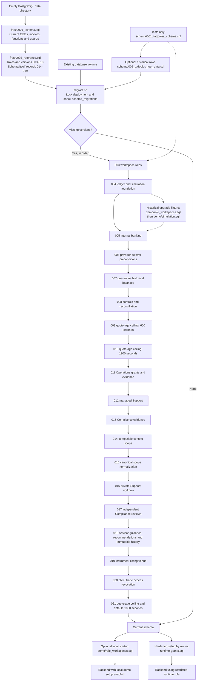

# Database guide

This directory contains SQL files, but a normal new installation does not execute all of them. PostgreSQL 15 is the supported database. The current schema includes private Support workflow, Compliance review, Advisor records, instrument listing venues, and client trade-access revocation through migration **020**. Initialize an empty database from `fresh/`, or upgrade an existing database through `migrations/`.

The split is intentional. A fresh schema describes the final structure; a migration describes how to reach that structure while preserving older data. Demo and historical test data are optional. Runtime grants are a separate security step.

## What was simplified

The duplicate `schema/003_workspace_roles.sql` and `schema/004_client_simulation.sql` were removed during the original cleanup. Tests and the upgrade rehearsal use their single authoritative copies in `migrations/`. Subsequent additive workspace migrations are listed below.

The remaining migrations were retained, including 009 and 010. An existing volume may already have applied one but not the other. Combining or renumbering them would make that upgrade history ambiguous. Historical fixtures remain because tests use them to prove old balances and records survive an upgrade correctly.

SQL and PL/pgSQL now have expanded statements, indentation and comments. This cleanup does not change SQL operations, literal values, permissions, financial rules or migration version numbers. The migration runner's generated script is also laid out for debugging.

## How the files are used



The migration branch is ordered, but the runner skips each already-recorded version individually. The dotted fixture branch is only for reconstructing an old simulation database in tests. It is not a normal startup path.

### Normal local Compose startup

1. PostgreSQL executes `fresh/*.sql` in filename order **only when its data directory is empty**. A retained volume skips this initialization.
2. The `database-migrate` service runs `migrate.sh` with `migrations/` mounted at `/migrations`.
3. The `database-demo-seed` service loads the optional local role accounts.
4. The catalog seeder imports `us-v1.json`, `crypto-v1.json`, and `fx-v1.json` as reference instruments and listing venues. It runs on existing volumes too, inserts missing instruments, and only refreshes the exchange field for existing matching symbols.
5. Local role accounts are seeded, then the backend starts. With `TRADING_LOCAL_DEMO_SETUP=true`, application code performs the controlled USD demo opening and provider validation for its supported trading instruments. Catalog import does not enable trading.

The hardened Compose override omits demo seeding/auth-stub dependencies and disables application demo setup. Its runtime role must be provisioned separately and granted access by the schema owner before the backend can use it. `runtime-grants.sql` is not automatically executed by Compose.

## Every SQL file and its dependencies

Paths below are relative to this directory. “Repeatable” means safe to rerun in its intended schema stage; it does not mean safe against arbitrary historical versions.

| File | What it does | Requires / when used | Repeatable? |
| --- | --- | --- | --- |
| [fresh/001_schema.sql](fresh/001_schema.sql) | Current schema through migration 019, including instrument listing venue, Advisor projections, attribution/eligibility/version guards and immutable history. No demo rows. | Empty database; normal Compose initialization and current-schema tests. Run before `002_reference.sql`. | No: tables already existing will conflict. |
| [fresh/002_reference.sql](fresh/002_reference.sql) | Adds the seven current application roles and records versions 3–13 represented by the fresh snapshot; `001_schema.sql` records versions 14–19. Prevents the runner from applying old structural changes again. | Fresh schema from the preceding file. **Never use this to mark an incomplete legacy upgrade as done.** | Yes; inserts use conflict handling. |
| [migrations/003_workspace_roles.sql](migrations/003_workspace_roles.sql) | Adds `TRADING_OPS` and `FINANCE`, plus indexes for ordered client trades and latest dated holdings. Preserves old `OPERATIONS` assignments. | Legacy base tables, before 004. The runner records version 3. | Yes, although the runner normally skips it afterward. |
| [migrations/004_client_simulation.sql](migrations/004_client_simulation.sql) | Introduces the self-directed order lifecycle, cash/position projections, reservations, quotes/decisions, fills, journals, durable jobs, events/outbox, sessions and database guards. Also introduces historical simulation policy fields. | Legacy schema; normally after 003. Foundation used by 005–010. | No; run once through the runner. |
| [migrations/005_client_banking.sql](migrations/005_client_banking.sql) | Adds encrypted bank references, internal USD movements and movement events. Gives cash-journal postings a movement source while requiring exactly one source. | 004, including its journal and guard functions. | No. |
| [migrations/006_trading_cutover.sql](migrations/006_trading_cutover.sql) | Refuses cutover while jobs/reservations remain active. Adds quarantine evidence, trading-availability flags, provider identity/permissions/revision fields and policy auditing. | 005; old application must first stop admission and drain commitments. | No. |
| [migrations/007_trading_openings.sql](migrations/007_trading_openings.sql) | Records historical balances/holdings/policies as evidence and quarantines uncertain balances. Creates missing zero USD accounts; disables old synthetic instruments/policies, removes fixture prices and blocks historical financial writes. Does not infer spendable USD from old scalar cash. | 006. Old simulation fixtures, if used by a test, must have been loaded before cutover. | No. |
| [migrations/008_trading_controls.sql](migrations/008_trading_controls.sql) | Adds provider setup results, stored reconciliation reports, system audit actors, and guards against changing ticker/currency/provider identity in place. | 007. | No. |
| [migrations/009_quote_cache_age.sql](migrations/009_quote_cache_age.sql) | Historical change to permit quote-age limits between 1 and 600 seconds. Changes a constraint, not existing policy values. | 008; retained so existing volumes have an ordered upgrade path. | No. |
| [migrations/010_quote_cache_twenty_minutes.sql](migrations/010_quote_cache_twenty_minutes.sql) | Historical step raising the configurable ceiling to 1200 seconds. | 009. | No. |
| [migrations/021_quote_stale_after_thirty_minutes.sql](migrations/021_quote_stale_after_thirty_minutes.sql) | Raises the quote-age ceiling and widens policies at the prior 1200-second default to 1800 seconds. Explicit provider stale flags still reject a quote. | Existing trading policy table. | No; preserves lower customized limits. |
| [migrations/018_advisor_workspace.sql](migrations/018_advisor_workspace.sql) | Adds dedicated guidance (including versioned NONE clears), active/archived recommendations and immutable attributed history. Projection triggers enforce advisor assignment/role, exact ownership eligibility and versions; history is appended atomically by a fixed-search-path security-definer trigger. No financial writes or automatic assignment. | Current chain through 017. Review/reapply runtime grants as the schema owner before a restricted runtime uses these APIs. | Runner skips recorded version 18; do not rerun its DDL manually. |
| [migrations/019_instrument_exchange.sql](migrations/019_instrument_exchange.sql) | Adds nullable listing-exchange metadata, separate from trading policy and provider venue. | Current chain through 018. | Runner skips recorded version 19; do not rerun manually. |
| [migrations/020_user_trade_access.sql](migrations/020_user_trade_access.sql) | Adds durable indefinite/timed client trade-access revocation fields and immutable operator-attributed access events. Expired timed revocations become eligible automatically. | Current chain through 019. Reapply runtime grants to enable the access-event insert. | Runner skips recorded version 20; do not rerun manually. |
| [catalog/seed.sql](catalog/seed.sql) | Imports the US equity/ETF, crypto and forex manifests. Crypto and forex are identified as OTC; US listings use sourced exchange names. Existing policies and other instrument fields are not overwritten. | Compose catalog-seed service, after migrations; database container mounts the three root JSON files at `/catalog`. | Yes; inserts are idempotent and existing rows only have exchange refreshed. |
| [demo/role_workspaces.sql](demo/role_workspaces.sql) | Creates seven fictitious local users, role assignments and client profiles, plus empty USD accounts when ledger tables exist. Includes `demo.advisor` / `Demo Advisor`, ADVISOR role and linked advisor; assigns only `demo.client` if unassigned, and rejects a conflicting existing advisor. Leaves `demo.client2` untouched. Uses `pgcrypto`; existing passwords and balances are retained. | Identity/client/advisor tables; normal local startup runs it after all migrations. Upgrade fixtures can use it after 004. | Yes; does not refill spent cash or overwrite assignments. |
| [demo/simulation.sql](demo/simulation.sql) | Historical fixture: synthetic instruments, deterministic prices and fictitious multi-currency openings. Lets tests reconstruct a pre-provider database and verify upgrade behavior. | 003/004 and role demo accounts, **before 006/007**. Incompatible with the current fresh schema because old columns have been removed. | Yes only at the old schema stage; opening references prevent refills. |
| [schema/001_tadpoles_schema.sql](schema/001_tadpoles_schema.sql) | Original identity/advisor/portfolio schema, dated holdings, scalar cash and legacy trades. Baseline for regression and upgrade tests. | Empty disposable database for historical tests. New application installs use `fresh/`. | No. |
| [schema/002_tadpoles_test_data.sql](schema/002_tadpoles_test_data.sql) | Historical rows with fixed IDs across the original portfolio model. Used by the Compose upgrade rehearsal to prove populated data survives. Password hashes are placeholders, not working demo logins. | Legacy base schema before migrations; not normal startup. | No; fixed IDs conflict on replay. |
| [runtime-grants.sql](runtime-grants.sql) | Gives an existing non-owner runtime login the required table/sequence access, removes destructive access to evidence, and rejects unsafe owner/superuser/member roles. Creates no login or password. | Current schema; execute as owner with `psql -v runtime_role=...`. Reapply/review when new tables require grants. | Yes for the intended safe runtime role. |

## Important concepts when debugging

**Schema versus data.** `CREATE TABLE`, indexes, constraints and functions define the structure. `INSERT`/`UPDATE` statements can change data. The fresh reference file only inserts role/version metadata; demo files insert fictitious accounts or historical test balances. Migrations can do both, especially the cutover in 007.

**Posted, reserved and available.** `client_cash_accounts` and `client_positions` are current balance projections. Available cash/units equal posted minus reserved. Their checks stop reservations exceeding balances. `cash_journal` and `position_journal` retain the underlying postings; deleting evidence to “fix” a balance destroys reconciliation.

**Triggers and functions.** A trigger automatically calls a function on an insert/update/delete. Guard functions reject changes to immutable evidence, settled order intent or economic instrument identity. The deferred lifecycle trigger checks at transaction commit, allowing the application to write an order and its matching event/fill in the same transaction. A trigger exception is usually an invariant violation to investigate, not a trigger to disable.

**Outbox and jobs.** Execution jobs retain worker retry/lease state so accepted orders survive a restart. An outbox stores committed event facts with the financial transaction; delivery bookkeeping can change afterward. Neither is a disposable quote cache.

**Quote age is not caching.** Files 009/010/021 alter the permitted `quote_max_age_seconds` range and 021 widens prior-default policies. There is no quote-cache table created by them. `order_quote_observations` stores audit evidence. The 30-minute quote-age policy and explicit provider stale/session flags still determine eligibility in application code. Widening this age limit does not refresh prices.

**Permissions.** Application roles such as `TRADING_OPS` are rows in `roles`/`user_roles`. A PostgreSQL runtime role is the database login used by the backend. They solve different problems. `runtime-grants.sql` configures the latter; it does not grant a user an application role.

## Migration execution and maintenance

`migrate.sh` holds advisory lock `7414014` in one `psql` session, preventing two deployment runners from applying the chain simultaneously. It reads zero-padded filenames in order and consults `schema_migrations` before each file. Versions 004–010 insert their own marker inside their `BEGIN`/`COMMIT` transaction; the runner also inserts the marker with conflict handling. A SQL failure stops the session. Version 003 is repeatable, so it can safely recover if its commit precedes the runner's marker insertion.

The runner tracks versions, **not file checksums**. Editing a recorded migration's behavior would not update an existing database. For future behavior changes:

1. Add the next numbered migration (currently `019_<purpose>.sql`), with preconditions, a transaction and its version marker.
2. Update the fresh snapshot to the same final structure and record its version marker alongside the corresponding DDL.
3. Update fresh-versus-upgrade tests and any explicit migration lists in backend tests. Test with existing data, not only an empty database.
4. Review runtime grants for new tables and update this guide/diagram.

Keep historical migrations as the upgrade contract. Formatting/comments may improve, but do not rewrite applied operations or renumber versions. The fresh snapshot is derived from the upgrade chain; its long dependency-ordered DDL is intentional. When regenerating it, use PostgreSQL 15 schema-only output without owner/privilege statements and review the result. Keep demo data and role grants outside the snapshot; include the migration markers that correspond to its DDL.

### Advisor deployment and privacy

Migration 018 is additive. Run the normal migration service before deploying the new backend; keep retained volumes. For hardened deployments, reapply this guide's owner-executed runtime-grants step: runtime gets SELECT/INSERT/UPDATE on advisory projections and SELECT-only on history, with direct history mutation and trigger-helper execution explicitly revoked. The history append trigger executes as its trusted schema owner with a fixed search path. Owner/superuser administration remains trusted; do not run the application as owner in hardened environments.

No history-browsing API is exposed to advisors or clients. History is retained for approved audit/support access under existing database access procedures; operators must not dump rationale/identity data into logs. Recommendations that become held are omitted from active API reads without deleting prior advice. Roll back application admission/routes without dropping tables/history or deleting volumes. Historical assignment timestamps remain unknown/null, and automatic production assignment is not part of 018.

## Choosing a startup path

Normal local startup is described in the [deployment guide](../docs/local_deploy_guide.md). Existing environment files and volumes contain state; do not delete a volume to resolve an upgrade failure.

For a **new empty disposable database** with `PGHOST`, `PGDATABASE`, `PGUSER` and password handling configured, run from the repository root:

```sh
psql -v ON_ERROR_STOP=1 -f database/fresh/001_schema.sql
psql -v ON_ERROR_STOP=1 -f database/fresh/002_reference.sql
# Optional fictitious local users:
psql -v ON_ERROR_STOP=1 -f database/demo/role_workspaces.sql
```

For an **existing application database**, use the migration service and its mounted `/migrations` directory. Do not rerun fresh DDL or all SQL files recursively. The runner is designed for its container mount and is not a host-path autodiscovery tool.

For a separately provisioned hardened runtime login, an owner runs:

```sh
psql -v ON_ERROR_STOP=1 -v runtime_role=YOUR_EXISTING_APP_ROLE -f database/runtime-grants.sql
```

Use `psql`, not a generic JDBC SQL console, for this file. Its `\if`, `\gset`, `\quit` and quoted variables are `psql` commands. Grant access before starting the backend with that login.

## Read-only troubleshooting

Start with the first failed SQL statement in `database-migrate` logs, then inspect the relevant version and database object. These queries do not change balances or migration history:

```sql
-- Which versions have actually been recorded?
SELECT version, applied_at
FROM schema_migrations
ORDER BY version;

-- Is a user's USD account blocked, reserved, or genuinely empty?
SELECT client_id, currency, posted, reserved,
       posted - reserved AS available, available_for_trading
FROM client_cash_accounts
ORDER BY client_id, currency;

-- Why is a symbol unavailable or its price considered too old?
SELECT i.ticker, i.is_active, p.enabled, p.provider_symbol,
       p.buy_allowed, p.sell_allowed, p.quote_max_age_seconds, p.revision
FROM instruments AS i
LEFT JOIN instrument_trading_policies AS p USING (instrument_id)
ORDER BY i.ticker;

-- Which historical records need explicit disposition after cutover?
SELECT kind, count(*)
FROM financial_migration_exceptions
GROUP BY kind
ORDER BY kind;
```

| Symptom | Where to look |
| --- | --- |
| “Relation already exists” during initialization | Check whether fresh DDL was run over an existing schema. Init scripts run only for empty PostgreSQL data directories. |
| Missing current tables | Confirm migration service success and versions 3-19. Do not manually insert version markers to bypass an incomplete migration. |
| Cutover blocked by jobs/reservations | Migration 006 is protecting accepted commitments. Stop new admission and drain with the previous application before retrying. |
| Historical cash exists but is unavailable | Inspect availability flags and `financial_migration_exceptions`; 007 deliberately quarantines uncertain funds. |
| “Permission denied” after hardened startup | Check the configured database login and owner-applied runtime grants, rather than adding application roles. |
| Demo login does not exist | Current demo identities come from `demo/role_workspaces.sql`; historical test hashes are not login credentials. |
| Catalog instrument is absent | Confirm `database-catalog-seed` completed, then check `is_active` and the catalog filters. Catalog import does not enable trading; provider/trading policy setup remains an Operations workflow. |

## Verification

Database tests use disposable PostgreSQL and reset their test schema. Never point them at a retained application database. The normal Maven path uses Testcontainers; the optional `ISOLATED_TEST_DB_URL` test path requires the dedicated `tadpoles_isolated_test` database.

```sh
mvn -f testing/pom.xml test
mvn -f backend/pom.xml test
cd frontend
npm test -- --watch=false
npm run build
npm run test:qof-styles
```

The database suite checks legacy constraints, migration preservation, simulation opening idempotency, banking, cutover quarantine, and fresh/upgrade equivalence. The equivalence check now includes indexes and stored-function bodies, alongside columns, constraints and triggers. Separate scripts exercise actual startup and recovery:

- `python3 scripts/test-client-compose.py`: isolated Compose startup, repeated startup, and a populated legacy-volume upgrade through the actual runner.
- `python3 scripts/test-client-recovery.py`: isolated restart, backup/restore, reconciliation and restricted-runtime-role behavior; requires a freshly packaged backend JAR.
- `python3 scripts/test-hardened-config.py`: read-only check of hardened Compose wiring.

All rehearsal scripts use disposable names and clean up their own resources. They do not validate a real market provider; their market data is an explicit test fixture.

### Cleanup verification — 2026-10-17

- **545 tests passed:** 378 backend, 19 database and 148 frontend, with no Maven failures/errors/skips.
- Production frontend build, backend packaging and the repository style check passed.
- Actual Compose fresh startup, repeat startup and populated legacy-volume upgrade passed, preserving users/orders/journals and quarantining unresolved historical balances.
- Restart, backup/restore, deposit/withdrawal replay, restricted-runtime booking, immutable evidence permissions, repeated migrations and reconciliation passed.
- The hardened Compose contract check passed. It now checks declarations without resolving private service `.env` files and explicitly verifies that the backend inherits none.
- An executable-token comparison against the pre-cleanup SQL confirmed that formatting/comments changed no operations or literal values in the retained SQL files. Shell syntax and whitespace checks on this cleanup's files passed.

The rehearsals removed their temporary containers, databases and volumes. No retained application database was migrated or reset by this cleanup.

## Operations investigation extension

Migration `011_operations_workspace.sql` adds explicit per-account grants and immutable grant events, expiring actor-owned purpose contexts, immutable access events, protected export artifacts, prospective decision contexts and scoped reconciliation findings. It projects known ownership from retained older reconciliation reports without rewriting those reports. Unknown ownership stays redacted. The fresh schema and reference markers include version 11. Reapply runtime grants after upgrade: the application may read grants but cannot provision or mutate them.

The detailed [Operations guide](../ImplementationDocumentation/Frontend/OperationsPageImplementation/OperationsRoleCrashCourse.MD) describes configuration, grant provisioning, scope, evidence coverage and download expiry. No production grants or automatic retention purge are seeded.


Standard local `docker compose build` followed by `docker compose up` runs `database/demo/seed-role-workspaces.sh` after migrations. It creates the existing role identities and, when local demo setup and Operations access are enabled, applies `database/demo/operations_workspace.sql` for `demo.client` only. No Operations overlay or manual grant SQL is required. The fixture seed is repeatable and preserves revocations. The separate `docker-compose.market-fixture.yml` remains an optional explicit synthetic-data test choice; normal startup uses the configured real provider. Hardened startup excludes the local seed service. The Operations guide above includes all five environment settings and error explanations by component.


## Managed support history

Migration `012_managed_support.sql` adds owned cases, immutable public activity, separate private notes, actor-scoped action receipts, owned recipient watermarks and private export associations. Composite ownership constraints bind optional linked orders; deferred checks keep public status/version/time consistent with history. Runtime privileges permit only the required projection and read-watermark updates and prohibit immutable support history mutation.

Purpose contexts now distinguish `EXTERNAL` and `MANAGED`, retaining verified case identity for managed investigations. Existing contexts default to external; no historical case or new account grant is fabricated. New `CASE_READ`/`CASE_UPDATE` permissions require explicit approved provisioning. Fresh DDL/reference markers include version 12. Reapply `runtime-grants.sql` after migration and check support readiness. Do not drop retained support rows during application rollback.
