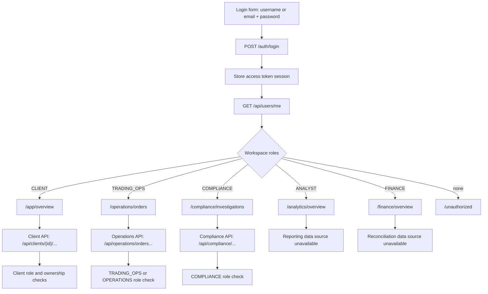

# Separate role pages implementation record

Date: 2026-10-13

## 1. Baseline and initial checks

- Verified current repo state and key files:
  - `frontend/src/app/app.routes.ts`, `app.routes.server.ts`, `core/auth/*`, `layout/authenticated-shell.component.ts`, `shared/top-nav/*`
  - `backend/src/main/java/com/neueda/leap/controller/*`, `service/*`, `mapper/*`
  - `database/schema/002_tadpoles_test_data.sql`
- Confirmed baseline gaps from instructions were still present:
  - Login bootstrap depended on `/api/users/me/profile` for all users.
  - No role-aware route groups or landing behavior.
  - Client ownership helper allowed non-client bypass.
  - Client/staff pages were not separated by canonical workspace routes.

## 2. Step-by-step implementation

1. Added centralized role normalization and landing priority
   - Files: `frontend/src/app/core/auth/workspace-roles.ts`
   - Why: keep role policy centralized, avoid scattered string aliasing.
   - Behavior:
     - Canonical roles: `CLIENT`, `TRADING_OPS`, `COMPLIANCE`, `ANALYST`, `FINANCE`
     - Legacy aliases normalized in one place: `OPERATIONS -> TRADING_OPS`, `REPORTING -> ANALYST`
     - Deterministic landing route priority implemented.

2. Reworked auth session bootstrap to use `/api/users/me` as authoritative identity
   - Files: `frontend/src/app/core/auth/auth.service.ts`
   - Why: support staff login and role-aware routing without forcing client profile calls.
   - Before:
     - Login always fetched `/api/users/me/profile`.
   - After:
     - Login stores token, then bootstraps identity from `/api/users/me`.
     - Client profile endpoint is called only when `CLIENT` role is present.
     - Added initialization state model (`loading`, `authenticated`, `unauthenticated`, `recoverable-failure`).
     - Added role-aware helpers: `roles`, `hasAnyRole`, `resolveLandingRoute`, `ensureInitialized`.

3. Replaced guards with explicit auth/workspace/onboarding separation
   - Files: `frontend/src/app/core/auth/auth.guard.ts`
   - Why: enforce child-route checks and safe redirects.
   - Added:
     - `authGuard` for authenticated shell
     - `onboardingGuard` for `/onboarding` logic
     - `workspaceGuard(...)` for role-specific routes
     - `clientWorkspaceGuard` for client + onboarding requirement
     - `rootLandingGuard` for `/` to authorized workspace
     - safe internal `redirectTo` validation

4. Replaced route map with role-specific route groups and dedicated pages
   - Files: `frontend/src/app/app.routes.ts`, `frontend/src/app/app.routes.server.ts`
   - Why: separate URLs for each workspace and client-render protected routes.
   - Added routes:
     - Public: `/login`, `/signup`, `/register`, `/unauthorized`, `/not-found`
     - Client: `/app/overview`, `/app/markets`, `/app/instruments/:id`, `/app/trade/:instrumentId`, `/app/portfolio`, `/app/orders`, `/app/orders/:id`
     - Operations: `/operations/orders`, `/operations/orders/:id`
     - Compliance: `/compliance/investigations`, `/compliance/investigations/:id`
     - Analyst: `/analytics/overview`, `/analytics/trends`, `/analytics/instruments`
     - Finance: `/finance/overview`, `/finance/reconciliation`
   - Kept `/trade/:symbol` for legacy market page compatibility.
   - Redirected legacy `/trades` to `/app/orders`.

5. Rebuilt top navigation as role-filtered workspace navigation
   - Files: `frontend/src/app/shared/top-nav/top-nav.component.ts`, `.html`, `.css`
   - Why: show only authorized workspace links and restrict ticker search to client workspace.
   - Changes:
     - Added computed workspace links based on assigned roles.
     - Search box hidden unless user has `CLIENT`.
     - Moved global listeners from decorators to `host` event bindings.

6. Created dedicated page components for new routes
   - Files:
     - Shared: `shared/unauthorized.component.ts`, `shared/not-found.component.ts`
     - API adapter: `core/api/workspace-api.service.ts`
     - Client: `features/client/{markets,instrument-detail,ticket,portfolio,orders,order-detail}.component.ts`
     - Operations: `features/operations/{orders,order-detail}.component.ts`
     - Compliance: `features/compliance/{investigations,investigation-detail}.component.ts`
     - Analytics: `features/analytics/{overview,trends,instruments}.component.ts`
     - Finance: `features/finance/{overview,reconciliation}.component.ts`
   - Notes:
     - Analytics/Finance pages currently show explicit unavailable states because isolated reporting/reconciliation storage APIs are not yet implemented in this repository.

7. Replaced sample dashboard content with API-backed client overview
   - Files: `frontend/src/app/dashboard.ts`, `frontend/src/app/dashboard.html`
   - Why: remove production sample account values and chart fixtures.
   - New overview uses client balance, holdings count, and recent order snapshot from live APIs.

8. Updated login input semantics for backend username-or-email behavior
   - Files: `frontend/src/app/login.ts`
   - Why: backend accepts username or email.
   - Changes:
     - Field changed from email-only to `usernameOrEmail`.
     - Removed signup-style login password-length rejection.

9. Repaired auth header attachment and restricted it to backend-targeted requests
   - Files: `frontend/src/app/core/auth/auth.interceptor.ts`, `frontend/src/app/user.service.ts`
   - Why: broken auth header construction prevented valid authorization behavior.
   - Result: interceptor adds `Authorization: Bearer <token>` only for intended backend routes.

10. Tightened backend authorization boundaries for client-mutating routes
    - Files:
      - `backend/src/main/java/com/neueda/leap/controller/SecurityRoleSupport.java`
      - `ClientController.java`, `ClientHoldingController.java`, `ClientTradeController.java`, `InstrumentController.java`
    - Why: close non-client bypass and unsafe authenticated writes.
    - Changes:
      - `requireClientOwnership` now requires actual `CLIENT` role (no non-client bypass).
      - Client trade/holding/balance/read-update routes require `hasRole('CLIENT')`.
      - Client creation endpoint moved to `ADMIN` only.
      - Instrument create/update endpoints moved to `ADMIN` only.

11. Added role-scoped staff read endpoints for operations and compliance
    - Files:
      - `backend/src/main/java/com/neueda/leap/controller/OperationsOrderController.java`
      - `backend/src/main/java/com/neueda/leap/controller/ComplianceController.java`
      - `backend/src/main/java/com/neueda/leap/dto/ComplianceEvidenceResponseDto.java`
      - `backend/src/main/java/com/neueda/leap/service/ClientTradeService.java`
      - `backend/src/main/java/com/neueda/leap/service/impl/ClientTradeServiceImpl.java`
      - `backend/src/main/java/com/neueda/leap/mapper/ClientTradeMapper.java`
    - Why: provide dedicated read-only staff routes instead of reusing client-owned endpoints.
    - Added:
      - `GET /api/operations/orders`
      - `GET /api/operations/orders/{orderId}`
      - `GET /api/compliance/investigations`
      - `GET /api/compliance/orders/{orderId}/evidence`

12. Seed compatibility updates for canonical role names
    - Files:
      - `backend/src/main/java/com/neueda/leap/service/impl/UserServiceImpl.java`
      - `database/schema/002_tadpoles_test_data.sql`
    - Changes:
      - Added `TRADING_OPS` and `FINANCE` to accepted role allowlist.
      - Seeded role rows for `TRADING_OPS` and `FINANCE`.

## 3. Failure investigations and fixes

- Frontend build initially failed with a guard type mismatch (`CanActivateFn` returning unresolved nested guard result).
  - Root cause: async guard composition around `workspaceGuard(...)` returned a broader type.
  - Fix: inlined client guard checks (`requireAuthenticated` + explicit role/onboarding checks).
  - Verified by subsequent successful frontend build.

- Frontend build initially failed before dependency install (`@angular/build` package missing).
  - Root cause: dependencies not installed in `frontend/`.
  - Fix: ran `npm --prefix frontend ci`.

## 4. Verification evidence (actual)

- Ran:
  - `npm --prefix frontend ci`
  - `npm --prefix frontend run build`
  - `mvn -f backend/pom.xml -DskipTests compile`
  - `mvn -f backend/pom.xml "-Dtest=ClientTradeControllerTest,ClientControllerTest,ClientHoldingControllerTest" "-Dserver.port=8082" test`
  - `mvn -f backend/pom.xml test`
  - `mvn -f testing/pom.xml test`
- Result:
  - Frontend build completed successfully after guard fix.
  - Backend compile passed.
  - Focused controller tests passed after updating expectations and client-auth fixtures for tightened authorization.
  - The full backend module initially failed during application-context startup because optional `SERVER_PORT` and Fauxnance settings were unresolved. Defaults were added to `backend/src/main/resources/application.yml`.
  - The full backend module then passed: 266 tests, 0 failures, 0 errors.
  - The separate Testcontainers PostgreSQL module could not start because Docker is unavailable in the execution environment. Its schema resolver was also corrected to recognize the checked-in `database/schema/001_tadpoles_schema.sql` filename.

## 5. Final route/API/role matrix (implemented)

- Client routes (`CLIENT`): `/app/overview`, `/app/markets`, `/app/instruments/:id`, `/app/trade/:instrumentId`, `/app/portfolio`, `/app/orders`, `/app/orders/:id`
- Operations routes (`TRADING_OPS` or legacy `OPERATIONS`): `/operations/orders`, `/operations/orders/:id`
- Compliance routes (`COMPLIANCE`): `/compliance/investigations`, `/compliance/investigations/:id`
- Analyst routes (`ANALYST` or legacy `REPORTING`): `/analytics/overview`, `/analytics/trends`, `/analytics/instruments`
- Finance routes (`FINANCE`): `/finance/overview`, `/finance/reconciliation`
- Shared public routes: `/login`, `/signup`, `/register`, `/unauthorized`, `/not-found`

## 6. Known remaining acceptance gaps

- Analytics and finance pages are present and role-protected, but still show explicit unavailable states because isolated reporting/reconciliation backends are not implemented here.
- No dedicated `/api/analytics/*` and `/api/finance/*` contracts were added in this slice.
- Existing order acceptance/attempt-key/idempotent workflow and complete order-event timeline remain legacy and need a dedicated backend contract evolution slice.
- API documentation (`docs/api.yaml`) was not yet updated for all newly added role-page endpoints in this slice.

## 7. Mermaid flow

